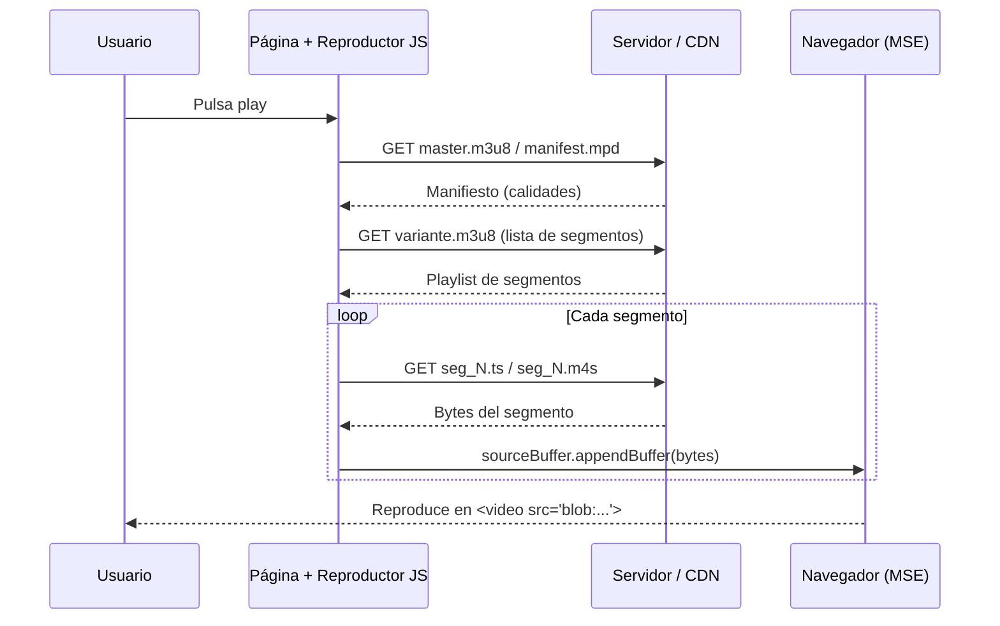
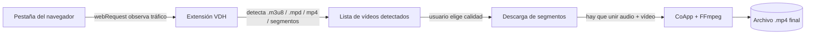
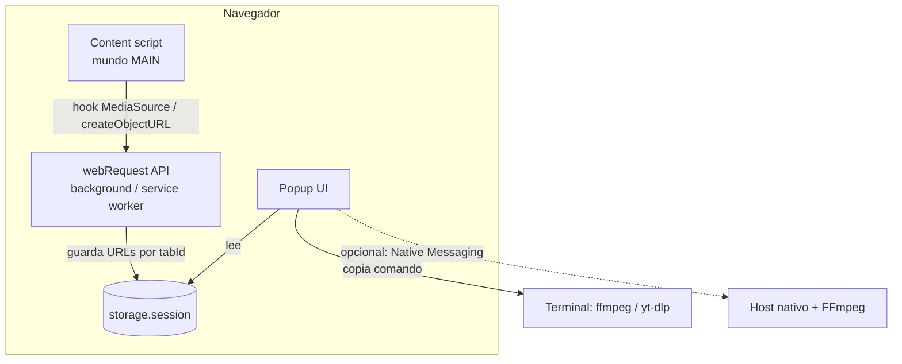

# Reconstrucción video en red: blob, HLS, DASH

> **Guía técnica para hacking ético** · Cómo funciona el streaming moderno, por qué el clic derecho no sirve, cómo reconstruir el vídeo final en MP4 (con audio) usando **Video DownloadHelper**, alternativas, y cómo construir tu propia herramienta.

---


**Aviso legal y ético**

Esta documentación tiene fines **educativos y de auditoría de seguridad**. Úsala únicamente sobre:

* Contenido de tu propiedad o con licencia que permita su descarga.
* Entornos de laboratorio, CTF o auditorías con **autorización expresa por escrito**.
* Material en dominio público o con licencias abiertas (Creative Commons, etc.).

Descargar contenido protegido por derechos de autor sin permiso puede incumplir los términos del servicio y la legislación aplicable. **Esta guía NO cubre la elusión de DRM** (Widevine, PlayReady, FairPlay); ese terreno queda explícitamente fuera de alcance (ver [sección 10](#10-drm-el-limite-que-no-se-cruza)).


---

## 📑 Índice

1. [Por qué el clic derecho no funciona](#1-por-que-el-clic-derecho-no-funciona)
2. [¿Qué es realmente `blob:`?](#2-que-es-realmente-blob)
3. [Streaming adaptativo: HLS y DASH](#3-streaming-adaptativo-hls-y-dash)
4. [El viaje completo del vídeo](#4-el-viaje-completo-del-video)
5. [Observar el tráfico con DevTools](#5-observar-el-trafico-con-devtools)
6. [Video DownloadHelper paso a paso](#6-video-downloadhelper-paso-a-paso)
7. [Cómo se reconstruye el MP4 final](#7-como-se-reconstruye-el-mp4-final)
8. [Método manual: DevTools + FFmpeg / yt-dlp](#8-metodo-manual-devtools--ffmpeg--yt-dlp)
9. [Problemas frecuentes (troubleshooting)](#9-problemas-frecuentes-troubleshooting)
10. [DRM: el límite que no se cruza](#10-drm-el-limite-que-no-se-cruza)
11. [Extensiones y herramientas recomendadas](#11-extensiones-y-herramientas-recomendadas)
12. [Crea tu propia extensión](#12-crea-tu-propia-extension)
13. [Enfoque de pentesting: qué se audita aquí](#13-enfoque-de-pentesting-que-se-audita-aqui)
14. [Glosario y checklist](#14-glosario-y-checklist)

---

## 1. Por qué el clic derecho no funciona

En la web "clásica", un vídeo era un archivo directo:

```html
<video src="https://ejemplo.com/video.mp4" controls></video>
```

El navegador descarga **un único archivo** y, al hacer clic derecho → *"Guardar vídeo como…"*, simplemente te guarda ese archivo.

Hoy casi ninguna plataforma seria sirve así el vídeo. Lo que ves en el DOM suele ser:

```html
<video src="blob:https://ejemplo.com/3f1c2a9e-8d0b-4c1f-9a77-5b1e0c6d2a10"></video>
```

Esa URL **no apunta a ningún servidor**. Es una referencia temporal a datos que **el propio JavaScript de la página ha ido montando en la memoria del navegador**. No hay un `.mp4` que guardar: el vídeo se está **ensamblando en directo** a partir de decenas o cientos de trozos pequeños.


**Motivos por los que las plataformas lo hacen así:**

* **Calidad adaptativa:** cambiar de 360p a 1080p según tu ancho de banda sin cortes.
* **Arranque rápido:** empiezas a ver el vídeo con los primeros segundos descargados.
* **Ahorro de tráfico:** no se descarga lo que no llegas a ver.
* **Control de acceso:** URLs firmadas, tokens que caducan, cabeceras obligatorias.
* **Protección de contenido** (a veces, no siempre, con DRM).


---

## 2. ¿Qué es realmente `blob:`?

### 2.1 `blob:` NO es un protocolo de red

Un error común es hablar del "protocolo blob". En realidad:

| Concepto | Qué es |
|---|---|
| `http://`, `https://` | Protocolos de red: viajan por Internet. |
| `blob:` | **Esquema de URL local**: apunta a un objeto en la memoria del navegador. |
| `data:` | Esquema de URL con los datos incrustados en la propia URL. |

Una URL `blob:` solo tiene sentido **dentro de esa pestaña / origen**. Si la copias y la abres en otro navegador, no existe.

### 2.2 Cómo nace una URL `blob:`

El JavaScript de la página crea un objeto y le pide al navegador una URL para él:

```javascript
const blob = new Blob([datosBinarios], { type: 'video/mp4' });
const url  = URL.createObjectURL(blob);   // → "blob:https://ejemplo.com/uuid..."
video.src  = url;
```

Para vídeo en streaming se usa algo más sofisticado: **Media Source Extensions (MSE)**.

### 2.3 Media Source Extensions (MSE): el motor del streaming web

MSE permite que JavaScript **alimente al reproductor con trozos de vídeo** que él mismo descarga.

```javascript
const mediaSource = new MediaSource();
video.src = URL.createObjectURL(mediaSource);        // ← aquí nace el blob:

mediaSource.addEventListener('sourceopen', async () => {
  const sb = mediaSource.addSourceBuffer('video/mp4; codecs="avc1.64001f"');

  for (const urlSegmento of listaDeSegmentos) {
    const datos = await fetch(urlSegmento).then(r => r.arrayBuffer());
    sb.appendBuffer(datos);                          // ← se "pega" al buffer
    await new Promise(r => sb.addEventListener('updateend', r, { once: true }));
  }
});
```

Es decir:

```
 Servidor ──(HTTP: segmentos)──► JavaScript (hls.js, dash.js, Shaka...) ──► SourceBuffer ──► <video src="blob:...">
```


**Idea clave:** el `blob:` es solo el "enchufe" final. Los datos reales **sí pasaron por la red** como peticiones HTTP normales. Por eso podemos interceptarlos: no necesitamos leer el blob, necesitamos **ver de dónde salen sus ingredientes**.


Librerías habituales que hacen este trabajo: **hls.js**, **dash.js**, **Shaka Player**, **Video.js** (con VHS), **JW Player**, **Bitmovin**.

---

## 3. Streaming adaptativo: HLS y DASH

Existen dos familias dominantes.

| | **HLS** | **MPEG-DASH** |
|---|---|---|
| Creador | Apple | Estándar ISO/MPEG |
| Archivo índice (manifiesto) | `.m3u8` | `.mpd` |
| Segmentos | `.ts` (MPEG-TS) o `.m4s`/`.mp4` (fMP4) | `.m4s` / `.mp4` (fMP4) |
| Formato del manifiesto | Texto plano | XML |
| Audio/vídeo | Pueden ir **mezclados** o **separados** | Casi siempre **separados** |

### 3.1 Anatomía de HLS

Un streaming HLS tiene normalmente **dos niveles de playlist**.

#### a) Master playlist (lista de calidades)

```m3u8
#EXTM3U
#EXT-X-STREAM-INF:BANDWIDTH=800000,RESOLUTION=640x360,CODECS="avc1.4d401e,mp4a.40.2"
360p/index.m3u8
#EXT-X-STREAM-INF:BANDWIDTH=2800000,RESOLUTION=1280x720,CODECS="avc1.4d401f,mp4a.40.2"
720p/index.m3u8
#EXT-X-STREAM-INF:BANDWIDTH=5000000,RESOLUTION=1920x1080,CODECS="avc1.640028,mp4a.40.2"
1080p/index.m3u8
```

Cada línea `#EXT-X-STREAM-INF` describe una **variante** (calidad) y la línea siguiente es la URL de su *media playlist*.

#### b) Media playlist (lista de segmentos)

```m3u8
#EXTM3U
#EXT-X-VERSION:3
#EXT-X-TARGETDURATION:6
#EXT-X-MEDIA-SEQUENCE:0
#EXTINF:6.000,
seg_000.ts
#EXTINF:6.000,
seg_001.ts
#EXTINF:6.000,
seg_002.ts
...
#EXT-X-ENDLIST
```

* `#EXTINF` → duración del segmento.
* `#EXT-X-ENDLIST` → es VOD (vídeo bajo demanda). Si **no** aparece, es un **directo** y la playlist se va actualizando.

#### c) Audio separado en HLS

```m3u8
#EXT-X-MEDIA:TYPE=AUDIO,GROUP-ID="aud",NAME="Español",LANGUAGE="es",URI="audio_es/index.m3u8"
```

Cuando existe `#EXT-X-MEDIA:TYPE=AUDIO`, el audio **no viene dentro** de los segmentos de vídeo. Hay que descargar **ambas pistas** y unirlas (*muxing*). Esta es la razón de que a veces las descargas "no tengan sonido".

#### d) Cifrado AES-128 estándar de HLS

```m3u8
#EXT-X-KEY:METHOD=AES-128,URI="https://ejemplo.com/key.bin",IV=0x0000...
```

Es un cifrado **estándar y público del protocolo**: la clave se entrega en una URL accesible para el reproductor, y por tanto también para cualquier cliente con los permisos adecuados. FFmpeg lo gestiona solo. **No es DRM** (no hay licencia por dispositivo).

### 3.2 Anatomía de DASH

```xml
<MPD type="static" mediaPresentationDuration="PT0H10M0S">
  <Period>
    <AdaptationSet mimeType="video/mp4" codecs="avc1.64001f">
      <Representation id="v720" bandwidth="2800000" width="1280" height="720">
        <SegmentTemplate initialization="v720/init.mp4"
                         media="v720/seg_$Number$.m4s"
                         startNumber="1" duration="4" timescale="1"/>
      </Representation>
    </AdaptationSet>
    <AdaptationSet mimeType="audio/mp4" codecs="mp4a.40.2" lang="es">
      <Representation id="a128" bandwidth="128000">
        <SegmentTemplate initialization="a128/init.mp4"
                         media="a128/seg_$Number$.m4s"
                         startNumber="1" duration="4" timescale="1"/>
      </Representation>
    </AdaptationSet>
  </Period>
</MPD>
```

Puntos clave:

* **`AdaptationSet`** = un tipo de contenido (vídeo, audio, subtítulos).
* **`Representation`** = una calidad concreta dentro de ese conjunto.
* **`initialization`** = el *init segment* (cabecera `moov` con codecs y parámetros). **Sin él, los `.m4s` no se pueden reproducir.**
* `$Number$` / `$Time$` = plantilla que se rellena para construir cada URL.

### 3.3 Contenedores: `.ts` vs fMP4

| Formato | Características |
|---|---|
| **MPEG-TS (`.ts`)** | Heredado de TV digital. Cada segmento es autosuficiente. Se concatenan fácilmente. |
| **fMP4 (`.m4s`, `.mp4`)** | MP4 fragmentado: un `init.mp4` + fragmentos `moof/mdat`. Es lo que MSE consume de forma nativa. |

---

## 4. El viaje completo del vídeo



**Todo lo que necesitamos está en las peticiones de la columna "P → S".** Una herramienta de captura solo tiene que:

1. **Detectar** el manifiesto (`.m3u8` / `.mpd`) o los segmentos.
2. **Descargar** todos los segmentos de la calidad elegida (vídeo + audio).
3. **Unirlos** en un único contenedor MP4 (*muxing*).

---

## 5. Observar el tráfico con DevTools

Antes de usar ninguna extensión conviene **entender qué ocurre**. Es el paso más didáctico y el que más se valora en una auditoría.

1. Abre la página y pulsa `F12` → pestaña **Network** (Red).
2. Recarga con `Ctrl+R` y **reproduce el vídeo**.
3. Usa el filtro y prueba con:
   * `m3u8`
   * `mpd`
   * `.ts` / `.m4s`
   * Tipo **Media** o **XHR/Fetch**
4. Haz clic en la petición del manifiesto:
   * **Headers** → URL completa, `Referer`, `Origin`, cookies, tokens.
   * **Response** → el contenido del manifiesto (¡léelo!).
5. Haz clic derecho sobre la petición → **Copy → Copy as cURL** para reproducirla desde terminal.


**Qué debes anotar en un informe:** URL del manifiesto, cabeceras obligatorias, si la URL está firmada/caduca (parámetros `token`, `expires`, `signature`, `hdnea`, `Policy`…), si hay cifrado `EXT-X-KEY`, y si hay indicios de DRM (peticiones a servidores de licencias).


**Truco para localizar el origen del blob.** En la consola:

```javascript
// ¿Qué hay realmente en el <video>?
document.querySelector('video').src
// "blob:https://..."  → montado por MSE
```

---

## 6. Video DownloadHelper paso a paso

**Video DownloadHelper (VDH)** es una de las extensiones más conocidas para Firefox, Chrome y Edge. Detecta streams en las peticiones de red de la pestaña y los ofrece como descargas.

### 6.1 Cómo funciona por dentro



1. **Observación pasiva:** usa la API `webRequest` del navegador para ver cada petición HTTP que hace la pestaña (igual que la pestaña Network).
2. **Clasificación:** reconoce por extensión, cabeceras `Content-Type` o contenido del manifiesto qué es un vídeo/stream.
3. **Descarga:** para streams HLS/DASH, baja el manifiesto, lo interpreta y descarga cada segmento.
4. **Ensamblado:** para unir y convertir (sobre todo audio + vídeo separados, o `.ts` → `.mp4`) necesita **FFmpeg**, que no puede ejecutarse dentro del navegador de forma nativa y eficiente. Por eso existe la **CoApp**.

### 6.2 Instalación

1. Instala la extensión desde la tienda oficial de tu navegador (Firefox Add-ons o Chrome Web Store) buscando **"Video DownloadHelper"** y comprobando que el desarrollador es el oficial.
2. Al instalarla, la extensión te indicará que necesita la **Companion Application (CoApp)** para ciertas funciones. **Instálala:** es el componente que incluye FFmpeg y puede escribir ficheros en disco y fusionar pistas.
3. Reinicia el navegador y, en la ventana de la extensión, revisa que aparece como *"CoApp instalada y funcionando"*.


Sin CoApp, muchas descargas HLS/DASH quedan **sin audio**, en formatos raros o directamente deshabilitadas. Si la extensión te muestra el aviso, no es un fallo: es una dependencia.


### 6.3 Descargar un vídeo (flujo de uso)

1. Abre la página y **reproduce el vídeo unos segundos** (la extensión necesita ver el tráfico).
2. El icono de VDH en la barra **se animará/mostrará un contador** al detectar streams.
3. Haz clic en el icono. Verás una lista de entradas detectadas, p. ej.:
   * Variantes de calidad (1080p, 720p, 360p…).
   * Entradas de **solo audio** o de **solo vídeo**.
   * Entradas de manifiesto (`master.m3u8`).
4. Elige **la calidad deseada**. Si hay opciones, prioriza las marcadas como **vídeo + audio** o *"Download and convert / merge"*.
5. Usa la acción de **descargar / descargar y convertir a MP4**. VDH descargará los segmentos y la CoApp los unirá.
6. Al terminar, el archivo aparece en tu carpeta de descargas (configurable en ajustes de la extensión).

### 6.4 Consejos de calidad

| Objetivo | Qué hacer |
|---|---|
| **Máxima calidad** | Elige la variante con mayor `RESOLUTION` / `BANDWIDTH`. Si la web solo muestra 720p mientras reproduces, fuerza 1080p en el selector de calidad del reproductor y vuelve a mirar. |
| **Que tenga sonido** | Selecciona una entrada con audio o la opción de fusión audio+vídeo. Revisa en [7.3](#73-fusion-de-audio-y-video-separados). |
| **Archivo universal** | Convierte a **MP4 (H.264 + AAC)**: es el combo más compatible. |
| **Directos largos** | Aumenta la tolerancia de red y comprueba el espacio en disco. |

### 6.5 Limitaciones esperables

* **URLs que caducan:** si pausas mucho tiempo o el token expira, la descarga falla a mitad.
* **DRM:** VDH no descarga (ni debe) contenido cifrado con Widevine/PlayReady/FairPlay.
* **Cambios de política de las tiendas:** las funciones disponibles pueden variar entre navegadores (Chrome/Manifest V3 es más restrictivo que Firefox).
* **Sitios que detectan extensiones** o exigen cabeceras particulares.

---

## 7. Cómo se reconstruye el MP4 final

Esta es la parte "mágica" que hace la CoApp (FFmpeg). Entenderla permite replicarla a mano o programarla.

### 7.1 Conceptos

* **Demuxing:** abrir un contenedor y separar sus pistas.
* **Muxing:** meter pistas (vídeo, audio, subs) en un contenedor.
* **Remuxing:** cambiar de contenedor **sin recodificar** → rapidísimo, **sin pérdida de calidad**.
* **Transcoding:** recodificar el contenido (más lento, con pérdida potencial).

> En el 99 % de los casos de HLS/DASH la reconstrucción es un **remux**: los códecs (H.264 + AAC) ya son compatibles con MP4.

### 7.2 Caso A: HLS con audio y vídeo mezclados (`.ts`)

Pasos lógicos:

1. Descargar `seg_000.ts … seg_N.ts` en orden.
2. Concatenarlos (los `.ts` se pueden concatenar byte a byte).
3. Remuxar a MP4.

Con FFmpeg, todo en uno:

```bash
ffmpeg -i "https://ejemplo.com/720p/index.m3u8" -c copy -bsf:a aac_adtstoasc salida.mp4
```

* `-c copy` → no recodifica.
* `-bsf:a aac_adtstoasc` → convierte el AAC en formato **ADTS** (propio de MPEG-TS) al formato **ASC** que exige MP4. Sin esto, FFmpeg suele dar error o el audio queda corrupto.

### 7.3 Fusión de audio y vídeo separados

Cuando el vídeo y el audio vienen en pistas distintas (muy típico en DASH y HLS moderno):

```bash
ffmpeg -i video.m3u8 -i audio.m3u8 -map 0:v:0 -map 1:a:0 -c copy salida.mp4
```

* `-i` dos veces → dos entradas.
* `-map 0:v:0` → toma el vídeo de la entrada 0.
* `-map 1:a:0` → toma el audio de la entrada 1.

### 7.4 Caso B: DASH / fMP4 (init + `.m4s`)

Un `.m4s` suelto **no se reproduce** porque le falta el `moov` del *init segment*. El procedimiento correcto es:

```
init.mp4  +  seg_1.m4s  +  seg_2.m4s  + ...   →  pista.mp4
```

Concatenar en binario (Linux/macOS):

```bash
cat init.mp4 seg_*.m4s > video_pista.mp4
cat init_a.mp4 seg_a_*.m4s > audio_pista.mp4
ffmpeg -i video_pista.mp4 -i audio_pista.mp4 -c copy final.mp4
```

> ⚠️ El orden numérico importa: `seg_10` va **después** de `seg_9`. Usa `sort -V` o genera la lista con un script.

O directamente, dándole el manifiesto a FFmpeg:

```bash
ffmpeg -i "https://ejemplo.com/manifest.mpd" -c copy salida.mp4
```

### 7.5 Cabeceras, cookies y tokens

Muchos CDN rechazan peticiones sin cabeceras correctas:

```bash
ffmpeg -headers $'Referer: https://ejemplo.com/\r\nUser-Agent: Mozilla/5.0\r\nCookie: sesion=abc\r\n' \
       -i "https://cdn.ejemplo.com/master.m3u8" -c copy salida.mp4
```

### 7.6 Resumen visual del reensamblado

```
 [master.m3u8] ─► elegir variante ─► [variante.m3u8]
                                         │
              ┌──────────────────────────┴───────────────┐
              ▼                                          ▼
     seg_000.ts ... seg_N.ts                     audio_000.aac ... audio_N.aac
              │                                          │
              └───────────── concatenar ─────────────────┘
                                   │
                           MUX (ffmpeg -c copy)
                                   ▼
                          🎞  salida.mp4  (H.264 + AAC)
```

---

## 8. Método manual: DevTools + FFmpeg / yt-dlp

Sirve de **verificación cruzada** cuando una extensión falla, o para scripts reproducibles en un informe.

### 8.1 Con FFmpeg

1. En DevTools localiza el `.m3u8` / `.mpd`.
2. *Copy as cURL* para conocer cabeceras necesarias.
3. Ejecuta:

```bash
ffmpeg -headers $'Referer: https://ejemplo.com/\r\n' \
       -i "URL_DEL_MANIFIESTO" \
       -c copy -bsf:a aac_adtstoasc salida.mp4
```

### 8.2 Con yt-dlp (muy recomendable)

```bash
# Ver formatos disponibles
yt-dlp -F "URL_DEL_MANIFIESTO_O_PAGINA"

# Mejor vídeo + mejor audio, fusionado a MP4
yt-dlp -f "bv*+ba/b" --merge-output-format mp4 "URL"

# Con cabeceras y cookies del navegador
yt-dlp --add-header "Referer:https://ejemplo.com/" \
       --cookies-from-browser firefox \
       -f "bv*+ba/b" --merge-output-format mp4 "URL"
```

### 8.3 Comprobar el resultado

```bash
ffprobe -hide_banner salida.mp4
```

Verifica que existen una pista `Video: h264` y una `Audio: aac`.

---

## 9. Problemas frecuentes (troubleshooting)

| Síntoma | Causa probable | Solución |
|---|---|---|
| **Sin audio** | Pista de audio separada no descargada | Elegir opción de fusión o descargar audio y unir con `-map` (7.3). |
| **Sin vídeo, solo audio** | Se descargó la variante equivocada | Elegir entrada con `RESOLUTION`. |
| **Error `403 Forbidden`** | Faltan `Referer`, `Origin`, cookies o token caducado | Copiar cabeceras desde DevTools; repetir con token reciente. |
| **Error `404` a mitad** | URL firmada caducó | Recargar la página y empezar de nuevo; descargar más rápido. |
| **MP4 que no abre** | `.m4s` sin `init.mp4` | Concatenar `init + segmentos` (7.4). |
| **Audio corrupto / distorsionado** | Faltó `aac_adtstoasc` | Añadir `-bsf:a aac_adtstoasc`. |
| **Vídeo "a trompicones"** | Segmentos desordenados | Ordenar numéricamente (`sort -V`). |
| **Solo ves un trozo del vídeo** | Es directo o hay varios *Periods* (anuncios) | Revisar el manifiesto; separar periodos. |
| **Pantalla negra al reproducir** | DRM (cifrado de licencia) | Fuera de alcance (sección 10). |
| **CoApp no detectada** | No instalada o bloqueada por el sistema | Reinstalar y reiniciar navegador. |
| **Calidad menor a la esperada** | El reproductor solo cargó una variante | Forzar calidad en el reproductor o descargar la variante desde el master. |

---

## 10. DRM: el límite que no se cruza

Es fundamental distinguir:

| | **Cifrado AES-128 de HLS** | **DRM (EME)** |
|---|---|---|
| Clave | URL accesible al reproductor | Licencia ligada al dispositivo y al CDM |
| Estándar | Parte del protocolo HLS | Encrypted Media Extensions + Widevine / PlayReady / FairPlay |
| Pista visible | `#EXT-X-KEY:METHOD=AES-128` | `<ContentProtection>` en el MPD, peticiones a servidor de licencias, `pssh` |
| Resultado de capturar segmentos | Se pueden descifrar con la clave pública | Segmentos **inútiles** sin licencia |

**Cómo reconocer DRM durante una auditoría:**

* En el MPD aparecen elementos `<ContentProtection schemeIdUri="urn:uuid:edef8ba9-...">` (Widevine) u otros esquemas.
* En la pestaña Network hay peticiones a endpoints tipo `license`, `widevine`, `drm`, `acquire`.
* El vídeo se ve **negro** en capturas de pantalla.
* En la consola, `navigator.requestMediaKeySystemAccess` fue invocado por el reproductor.

**Qué hacer en un informe:** documentar que el contenido está protegido por DRM y que **la descarga mediante captura de red no es aplicable**. Eso es un **hallazgo positivo** (control de seguridad correcto), no un obstáculo que "saltar".

---

## 11. Extensiones y herramientas recomendadas


La disponibilidad y funciones de las extensiones cambian con las políticas de cada tienda. Verifica siempre el desarrollador oficial y la última versión antes de instalar.


### 11.1 Extensiones de navegador

| Herramienta | Para qué sirve | Notas |
|---|---|---|
| **Video DownloadHelper** | Detección y descarga de vídeo/streams; CoApp para fusionar | Referencia del sector. Firefox es su mejor entorno. |
| **Stream Detector** | Detecta URLs de `.m3u8`/`.mpd` y las muestra/copia | Ideal para sacar el manifiesto y pasarlo a FFmpeg/yt-dlp. |
| **HLS Downloader** (y similares) | Descarga streams HLS directamente desde el navegador | Útil cuando no quieres instalar CoApp. |
| **Extensiones de "Copy as cURL" / inspección de red** | Auditar cabeceras y peticiones | Complementan a DevTools. |

### 11.2 Herramientas de línea de comandos (las más potentes)

| Herramienta | Uso |
|---|---|
| **FFmpeg** | La navaja suiza: demux, mux, transcodificar. |
| **yt-dlp** | Descarga desde miles de sitios y manifiestos; fusiona audio+vídeo; soporta cookies y cabeceras. |
| **Streamlink** | Pensado para directos (HLS/DASH). |
| **N_m3u8DL-RE** | Descargador de HLS/DASH muy completo (multihilo, selección de pistas, subtítulos). |
| **JDownloader 2** | Gestor de descargas con detección automática. |
| **mitmproxy / Burp Suite / Fiddler** | Interceptación de tráfico para auditar cabeceras, tokens y flujo completo. |

### 11.3 Flujo recomendado en una auditoría

```
1. DevTools / mitmproxy  →  entender el flujo y localizar manifiesto
2. Stream Detector / VDH →  confirmación rápida
3. yt-dlp / FFmpeg       →  reproducir de forma scriptable y documentar comandos
4. Informe               →  tokens, caducidad, cabeceras, DRM, hallazgos
```

---

## 12. Crea tu propia extensión

Construir una herramienta propia es la mejor forma de **entender de verdad** el proceso. Vamos a crear una extensión mínima que:

1. **Detecta** manifiestos `.m3u8` / `.mpd` en la pestaña.
2. **Los lista** en un popup.
3. **Genera el comando FFmpeg / yt-dlp** listo para copiar (con cabeceras).
4. *(Avanzado)* Descarga y une segmentos HLS en el propio navegador.

### 12.1 Arquitectura



### 12.2 `manifest.json` (Manifest V3, válido en Chrome/Edge)

```json
{
  "manifest_version": 3,
  "name": "StreamSniffer Lab",
  "version": "1.0.0",
  "description": "Herramienta educativa para auditar streams HLS/DASH.",
  "permissions": ["webRequest", "storage", "tabs", "downloads", "clipboardWrite"],
  "host_permissions": ["<all_urls>"],
  "background": { "service_worker": "background.js" },
  "action": { "default_popup": "popup.html", "default_title": "StreamSniffer" },
  "content_scripts": [
    {
      "matches": ["<all_urls>"],
      "js": ["hook.js"],
      "run_at": "document_start",
      "world": "MAIN"
    }
  ]
}
```

> 💡 En **Firefox** el `manifest.json` es casi igual, pero con `"background": { "scripts": ["background.js"] }` y el bloque `browser_specific_settings` con tu ID. Firefox sigue permitiendo `webRequest` bloqueante; Chrome MV3 solo permite **observar**, que es justo lo que necesitamos.

### 12.3 `background.js`: detectar manifiestos

```javascript
// Patrones que nos interesan
const PATRON = /\.(m3u8|mpd)(\?|$)/i;

// Memoria por pestaña: { tabId: [ {url, tipo, cabeceras} ] }
const porPestana = new Map();

chrome.webRequest.onSendHeaders.addListener(
  (det) => {
    if (det.tabId < 0) return;                       // peticiones ajenas a pestañas
    if (!PATRON.test(det.url)) return;

    const tipo = /\.m3u8/i.test(det.url) ? 'HLS' : 'DASH';

    // Cabeceras que suelen importar al CDN
    const importantes = {};
    for (const h of det.requestHeaders || []) {
      const n = h.name.toLowerCase();
      if (['referer', 'origin', 'user-agent', 'cookie', 'authorization'].includes(n)) {
        importantes[h.name] = h.value;
      }
    }

    const lista = porPestana.get(det.tabId) || [];
    if (!lista.some((x) => x.url === det.url)) {
      lista.push({ url: det.url, tipo, cabeceras: importantes, ts: Date.now() });
      porPestana.set(det.tabId, lista);
      chrome.action.setBadgeText({ tabId: det.tabId, text: String(lista.length) });
    }
  },
  { urls: ['<all_urls>'] },
  ['requestHeaders', 'extraHeaders']
);

// Limpiar al navegar o cerrar
chrome.tabs.onRemoved.addListener((id) => porPestana.delete(id));
chrome.tabs.onUpdated.addListener((id, info) => {
  if (info.status === 'loading') {
    porPestana.delete(id);
    chrome.action.setBadgeText({ tabId: id, text: '' });
  }
});

// El popup pide los datos
chrome.runtime.onMessage.addListener((msg, _s, responder) => {
  if (msg.accion === 'listar') {
    responder(porPestana.get(msg.tabId) || []);
  }
  return true;
});
```

### 12.4 `hook.js`: ver quién fabrica el `blob:` (mundo MAIN)

Este *content script* se inyecta en el contexto de la propia página y **envuelve** las APIs para registrar qué ocurre. Es una técnica de análisis muy didáctica.

```javascript
(() => {
  // 1) ¿Quién crea URLs blob?
  const original = URL.createObjectURL;
  URL.createObjectURL = function (obj) {
    const url = original.apply(this, arguments);
    const tipo = obj instanceof MediaSource ? 'MediaSource'
               : obj instanceof Blob        ? `Blob(${obj.type})`
               : typeof obj;
    console.info('[StreamSniffer] createObjectURL →', url, tipo);
    return url;
  };

  // 2) ¿Qué códecs se piden al SourceBuffer?
  const addSB = MediaSource.prototype.addSourceBuffer;
  MediaSource.prototype.addSourceBuffer = function (mime) {
    console.info('[StreamSniffer] addSourceBuffer →', mime);
    return addSB.call(this, mime);
  };
})();
```

Qué aprenderás con ella: el MIME exacto (`video/mp4; codecs="avc1…"`), si el audio y el vídeo usan `SourceBuffer` separados, y si el reproductor es MSE puro.

### 12.5 `popup.html` + `popup.js`

```html
<!-- popup.html -->
<!doctype html>
<html>
<head>
  <meta charset="utf-8" />
  <style>
    body { font: 13px system-ui; width: 480px; padding: 10px; }
    .item { border: 1px solid #ccc; border-radius: 6px; padding: 8px; margin-bottom: 8px; }
    code { display: block; background: #111; color: #0f0; padding: 6px; border-radius: 4px;
           white-space: pre-wrap; word-break: break-all; margin: 6px 0; }
    button { cursor: pointer; }
  </style>
</head>
<body>
  <h3>🎬 StreamSniffer Lab</h3>
  <div id="lista">Reproduce un vídeo y vuelve a abrir esto…</div>
  <script src="popup.js"></script>
</body>
</html>
```

```javascript
// popup.js
function comandoFFmpeg(item) {
  const h = item.cabeceras;
  const hdr = Object.entries(h)
    .filter(([k]) => k.toLowerCase() !== 'cookie')   // las cookies, mejor manual
    .map(([k, v]) => `${k}: ${v}`)
    .join('\\r\\n');
  return `ffmpeg -headers $'${hdr}\\r\\n' -i "${item.url}" -c copy -bsf:a aac_adtstoasc salida.mp4`;
}

function comandoYtDlp(item) {
  const ref = item.cabeceras.Referer || item.cabeceras.referer || '';
  return `yt-dlp ${ref ? `--add-header "Referer:${ref}" ` : ''}-f "bv*+ba/b" --merge-output-format mp4 "${item.url}"`;
}

(async () => {
  const [tab] = await chrome.tabs.query({ active: true, currentWindow: true });
  const items = await chrome.runtime.sendMessage({ accion: 'listar', tabId: tab.id });
  const cont = document.getElementById('lista');
  if (!items.length) return;
  cont.innerHTML = '';

  for (const it of items) {
    const div = document.createElement('div');
    div.className = 'item';
    div.innerHTML = `<b>${it.tipo}</b><br><small></small>`;
    div.querySelector('small').textContent = it.url;

    for (const [nombre, fn] of [['FFmpeg', comandoFFmpeg], ['yt-dlp', comandoYtDlp]]) {
      const cmd = fn(it);
      const pre = document.createElement('code');
      pre.textContent = cmd;
      const btn = document.createElement('button');
      btn.textContent = `Copiar ${nombre}`;
      btn.onclick = () => navigator.clipboard.writeText(cmd);
      div.append(pre, btn);
    }
    cont.append(div);
  }
})();
```

### 12.6 Cargar la extensión en modo desarrollador

**Chrome / Edge**

1. Abre `chrome://extensions` (o `edge://extensions`).
2. Activa **Modo de desarrollador**.
3. Pulsa **Cargar descomprimida** y elige la carpeta del proyecto.

**Firefox**

1. Abre `about:debugging#/runtime/this-firefox`.
2. **Cargar complemento temporal…** y selecciona el `manifest.json`.

### 12.7 Nivel avanzado: descargar y unir **dentro del navegador**

Si quieres una herramienta autónoma sin CoApp, necesitas tres piezas.

**1) Parsear la playlist y resolver URLs relativas**

```javascript
async function obtenerSegmentos(urlMedia) {
  const txt = await (await fetch(urlMedia, { credentials: 'include' })).text();
  const base = new URL(urlMedia);
  return txt
    .split('\n')
    .map((l) => l.trim())
    .filter((l) => l && !l.startsWith('#'))
    .map((l) => new URL(l, base).href);
}
```

**2) Descargar con concurrencia limitada y en orden**

```javascript
async function descargarSegmentos(urls, concurrencia = 6, onProgreso = () => {}) {
  const resultado = new Array(urls.length);
  let siguiente = 0, hechos = 0;

  async function worker() {
    while (siguiente < urls.length) {
      const i = siguiente++;
      for (let intento = 0; intento < 3; intento++) {       // reintentos
        try {
          const r = await fetch(urls[i], { credentials: 'include' });
          if (!r.ok) throw new Error(r.status);
          resultado[i] = await r.arrayBuffer();
          break;
        } catch (e) {
          if (intento === 2) throw e;
        }
      }
      onProgreso(++hechos, urls.length);
    }
  }
  await Promise.all(Array.from({ length: concurrencia }, worker));
  return resultado;                                          // ¡en orden!
}
```

**3) Convertir a MP4**

Aquí tienes tres caminos:

| Opción | Cómo | Pros / contras |
|---|---|---|
| **mux.js** (transmuxer TS → fMP4) | Libreria JS ligera que convierte segmentos MPEG-TS a fragmentos MP4 | Rápido y ligero. Ideal para HLS con `.ts`. |
| **ffmpeg.wasm** | FFmpeg compilado a WebAssembly | Muy flexible (fusiona audio+vídeo, `-c copy`), pero pesado y más lento con archivos grandes. |
| **Native Messaging** | La extensión habla con un programa local que ejecuta FFmpeg real | Es lo que hace VDH con la CoApp. Máximo rendimiento, requiere instalar el host. |

Ejemplo conceptual con **ffmpeg.wasm**:

```javascript
// Pseudocódigo: la API exacta varía según la versión de @ffmpeg/ffmpeg
import { FFmpeg } from '@ffmpeg/ffmpeg';

const ffmpeg = new FFmpeg();
await ffmpeg.load();

await ffmpeg.writeFile('video.ts', new Uint8Array(unirBuffers(segmentosVideo)));
await ffmpeg.writeFile('audio.ts', new Uint8Array(unirBuffers(segmentosAudio)));

await ffmpeg.exec([
  '-i', 'video.ts', '-i', 'audio.ts',
  '-map', '0:v:0', '-map', '1:a:0',
  '-c', 'copy', '-bsf:a', 'aac_adtstoasc',
  'salida.mp4'
]);

const datos = await ffmpeg.readFile('salida.mp4');
const url = URL.createObjectURL(new Blob([datos.buffer], { type: 'video/mp4' }));
chrome.downloads.download({ url, filename: 'salida.mp4' });
```

```javascript
function unirBuffers(lista) {
  const total = lista.reduce((n, b) => n + b.byteLength, 0);
  const out = new Uint8Array(total);
  let off = 0;
  for (const b of lista) { out.set(new Uint8Array(b), off); off += b.byteLength; }
  return out;
}
```

> ⚠️ En Manifest V3 el *service worker* se suspende y no tiene `URL.createObjectURL`. Para procesos pesados usa un **Offscreen Document** (`chrome.offscreen`) o una página de extensión propia.

**4) Cifrado AES-128 estándar (si existe `#EXT-X-KEY`)**

```javascript
async function descifrarSegmento(buffer, claveBytes, ivBytes) {
  const key = await crypto.subtle.importKey('raw', claveBytes, 'AES-CBC', false, ['decrypt']);
  return crypto.subtle.decrypt({ name: 'AES-CBC', iv: ivBytes }, key, buffer);
}
// Si no hay IV explícito, se usa el número de secuencia del segmento como IV (128 bits, big-endian).
```

### 12.8 Mejoras para tu herramienta

* ✅ **Selector de calidad:** parsear el master playlist y listar `RESOLUTION` / `BANDWIDTH`.
* ✅ **Parser de DASH:** `DOMParser` + expansión de `SegmentTemplate`, `SegmentTimeline`, `BaseURL`.
* ✅ **Detección de DRM:** buscar `ContentProtection` y `EXT-X-KEY` con `KEYFORMAT` ≠ `identity`, y avisar al usuario.
* ✅ **Barra de progreso, reanudación y reintentos.**
* ✅ **Exportar un `.har` o informe** con URLs, cabeceras y caducidad del token → perfecto para entregables de pentesting.
* ✅ **Modo Native Messaging** para delegar la fusión en FFmpeg local.

### 12.9 Errores típicos al desarrollar

| Problema | Causa | Solución |
|---|---|---|
| CORS al hacer `fetch` de segmentos | El CDN no permite el origen | Hacer la petición desde el service worker/extensión con `host_permissions`. |
| El *service worker* "se duerme" | MV3 lo suspende a los 30 s sin actividad | Usar `chrome.offscreen`, `alarms` o dividir en tareas cortas. |
| Cookies no enviadas | Falta `credentials: 'include'` | Añadirlo y verificar permisos de host. |
| Memoria agotada con vídeos largos | Todo en RAM | Escribir a disco por trozos (File System Access API / `downloads`) o usar host nativo. |
| `webRequest` no ve peticiones | Falta `host_permissions` | Añadir `<all_urls>` o los dominios necesarios. |

---

## 13. Enfoque de pentesting: qué se audita aquí

Cuando este flujo aparece en un trabajo de hacking ético, **no se trata de "bajar un vídeo"**, sino de evaluar los controles de acceso del sistema:

| Control | Qué comprobar |
|---|---|
| **Autorización** | ¿Se puede obtener el manifiesto sin sesión? ¿Un usuario sin suscripción llega a las URLs? |
| **URLs firmadas** | ¿Caducan? ¿Se pueden reutilizar desde otra IP? ¿Están ligadas a sesión/dispositivo? |
| **Cabeceras** | ¿Se valida `Referer`/`Origin`? (recuerda: son fácilmente falsificables → no es un control fuerte). |
| **Enumeración / IDOR** | ¿Se pueden adivinar rutas de otros vídeos (`/video/123/`, `/video/124/`)? |
| **Hotlinking** | ¿Otro sitio puede incrustar el stream sin permiso? |
| **Configuración del CDN** | ¿Listado de directorios habilitado? ¿CORS excesivamente abierto (`*`)? |
| **Cifrado de claves** | ¿La URL de `EXT-X-KEY` exige autenticación? |
| **DRM** | ¿El contenido premium está realmente protegido o solo "ofuscado"? |
| **Rate limiting** | ¿Se pueden descargar masivamente segmentos sin límite? |

**Recomendaciones típicas para el cliente:**

1. Tokens de corta duración ligados a sesión y, si procede, a IP/dispositivo.
2. DRM para contenido de alto valor.
3. Autenticación en el endpoint de claves.
4. Monitorización de patrones de descarga anómalos.
5. Marca de agua (visible o forense) para trazabilidad de filtraciones.

> 📝 Recuerda: **cualquier cosa que el navegador pueda reproducir sin DRM, es técnicamente capturable.** La defensa real es controlar *quién* obtiene los manifiestos y cuánto duran, no esconder el vídeo detrás de un `blob:`.

---

## 14. Glosario y checklist

### 📖 Glosario

| Término | Definición |
|---|---|
| **Blob** | Objeto binario inmutable en memoria del navegador. |
| **`blob:` URL** | Referencia local a un Blob o MediaSource. |
| **MSE** | Media Source Extensions: API para alimentar `<video>` con datos generados por JS. |
| **EME** | Encrypted Media Extensions: API para reproducir contenido con DRM. |
| **HLS** | HTTP Live Streaming (Apple). Manifiesto `.m3u8`. |
| **DASH** | Dynamic Adaptive Streaming over HTTP. Manifiesto `.mpd`. |
| **Manifiesto / Playlist** | Archivo índice con calidades y segmentos. |
| **Segmento** | Trozo corto de vídeo/audio (2–10 s). |
| **Init segment** | Cabecera fMP4 con códecs y parámetros (`moov`). |
| **Muxing / Remuxing** | Empaquetar pistas en un contenedor, sin / con cambio de contenedor. |
| **Transcodificar** | Recodificar el contenido con otro códec. |
| **CoApp** | Aplicación auxiliar nativa de VDH (incluye FFmpeg). |
| **CDN** | Red de distribución de contenido que sirve los segmentos. |
| **ADTS / ASC** | Dos formas de empaquetar AAC (TS vs MP4). |

### ✅ Checklist rápida

- [ ] Tengo **autorización** o el contenido es mío / libre.
- [ ] He reproducido el vídeo y observado **Network** (`m3u8`/`mpd`).
- [ ] He identificado si hay **audio separado**.
- [ ] He revisado si hay **DRM** (si lo hay: me detengo y lo documento).
- [ ] He copiado **cabeceras/cookies** necesarias.
- [ ] He elegido la **calidad máxima** disponible.
- [ ] He descargado con VDH (con CoApp) **o** con `yt-dlp`/`ffmpeg`.
- [ ] He verificado con `ffprobe` que hay **H.264 + AAC**.
- [ ] He documentado URLs, caducidad de tokens y hallazgos.

---

## 📚 Referencias para profundizar

* Especificación HLS (RFC 8216).
* Especificación MPEG-DASH (ISO/IEC 23009-1).
* Documentación de **Media Source Extensions** y **Encrypted Media Extensions** en MDN.
* Documentación oficial de **FFmpeg** (`ffmpeg-formats`, `ffmpeg-protocols`).
* Repositorio y wiki de **yt-dlp**.
* Documentación de **Chrome Extensions (Manifest V3)** y **MDN WebExtensions**.
* Repositorios de **hls.js**, **dash.js**, **Shaka Player** y **mux.js** (leer su código es la mejor forma de entender el streaming).

---

*Documento elaborado con fines formativos para la comunidad de hacking ético. Usa estos conocimientos de forma responsable.*
