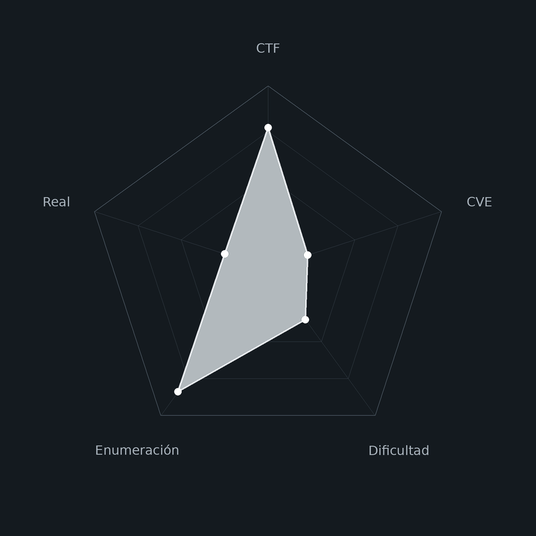
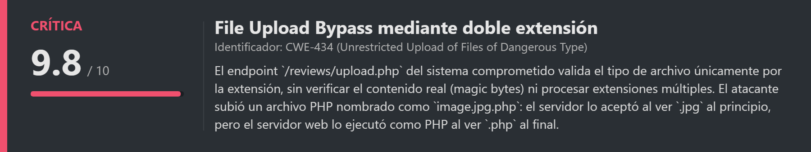
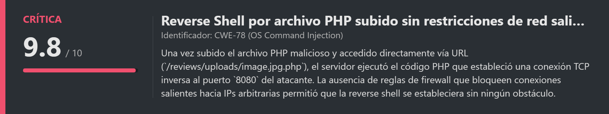
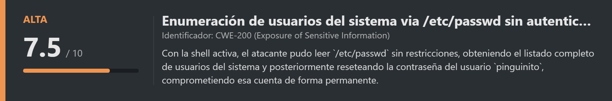
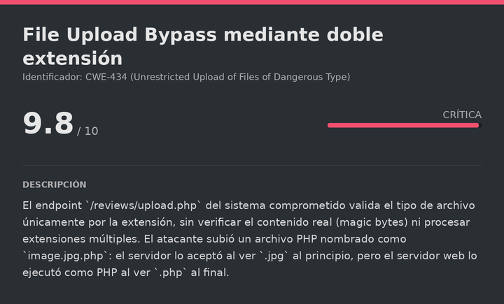
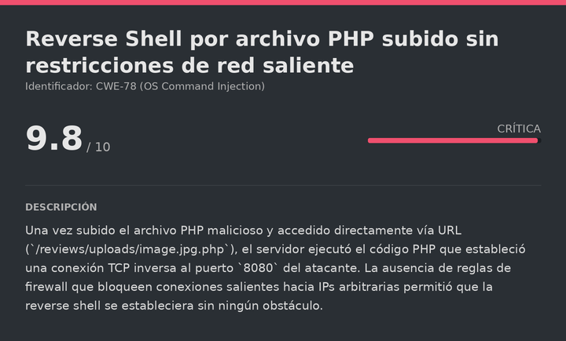
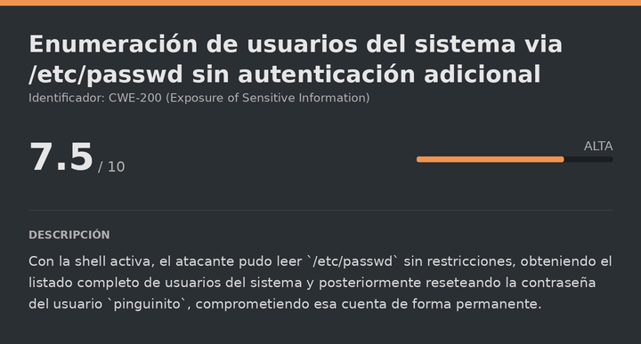

# Analyst DockerLabs (Easy)

# Contexto de la maquina
## Trayectoria Analyst

<figure><figcaption></figcaption></figure>

## Descripción

**Analyst** es una máquina Linux de dificultad **Easy** en DockerLabs con un enfoque completamente diferente al resto: no hay que comprometer el servidor, sino **actuar como analista de Blue Team**. La aplicación simula el escenario forense *"El caso de Pinguinito"*, donde se nos proporciona una captura de red `.pcap` y un feed de inteligencia de amenazas en `.json` para reconstruir un ataque que ya ocurrió y responder preguntas sobre él.

El ataque documentado en la captura sigue la secuencia clásica de un **file upload bypass** con reverse shell: un atacante desde `198.51.100.23` (Vietnam) realiza reconocimiento HTTP con un User-Agent de bot personalizado, localiza el endpoint de subida de archivos, bypasea el filtro de extensiones subiendo un archivo PHP con doble extensión (`image.jpg.php`), activa la reverse shell que se conecta al puerto `8080` del atacante, y desde esa shell lee `/etc/passwd` y resetea la contraseña del usuario `pinguinito`.

**Objetivo**

- Descargar y analizar el `.pcap` y el feed `.json` de la aplicación web.
- Responder correctamente las preguntas del laboratorio reconstruyendo el ataque desde Wireshark.
- Identificar: IP del atacante, país de origen, User-Agent, ruta de upload, nombre del archivo malicioso, puerto de la reverse shell, archivo leído y usuario comprometido.

**Tipo de máquina**

- Plataforma: DockerLabs
- Sistema operativo: Linux (Debian)
- Categoría principal: Blue Team / Network Forensics
- Componentes involucrados:
    - Aplicación web de análisis de incidentes (Gunicorn + Python).
    - Captura de red PCAP con el ataque completo.
    - Feed de inteligencia de amenazas en JSON.
    - Wireshark para análisis de tráfico.
## Análisis de vulnerabilidades (en el sistema atacado)

<figure><figcaption></figcaption></figure>
<figure><figcaption></figcaption></figure>
<figure><figcaption></figcaption></figure>

## Instalación

Cuando obtenemos el `.zip` lo pasamos al entorno de trabajo y lo descomprimimos:

```shell
unzip analyst.zip
```

Montamos la máquina con el script de despliegue automático de DockerLabs:

```shell
bash auto_deploy.sh analyst.tar
```

Respuesta:

```
Máquina desplegada, su dirección IP es --> 172.17.0.2

Presiona Ctrl+C cuando termines con la máquina para eliminarla
```

Cuando terminemos le damos a `Ctrl+C` para eliminar el contenedor y no dejar archivos residuales.
# Escaneo de puertos

<figure><figcaption></figcaption></figure>

```shell
nmap -p- --open -sS --min-rate 5000 -vvv -n -Pn <IP>
```

```shell
nmap -sCV -p<PORTS> <IP>
```

Respuesta:

```
Starting Nmap 7.99 ( https://nmap.org ) at 2026-10-07 18:53 +0000
Nmap scan report for 172.17.0.2
Host is up (0.000093s latency).

PORT   STATE SERVICE VERSION
22/tcp open  ssh     OpenSSH 10.0p2 Debian 7+deb13u4 (protocol 2.0)
80/tcp open  http    Gunicorn
|_http-title: El caso de Pinguinito — Lab Blue Team
```

Dos puertos abiertos:

- **Puerto 22** → SSH (OpenSSH 10.0p2), no necesario para este reto.
- **Puerto 80** → HTTP servido por Gunicorn (Python). Aloja la aplicación del laboratorio Blue Team.
## Acceso a la aplicación y descarga de evidencias

Accedemos a la aplicación:

```
URL = http://<IP>/
```

Respuesta:

<figure><figcaption></figcaption></figure>

Encontramos el laboratorio *"El caso de Pinguinito"*. Bajando en la página hay dos archivos descargables:

- `traffic_capture.pcap` → la captura de red con el ataque completo.
- `threat_intel_feed.json` → un feed de inteligencia de amenazas con información sobre IPs conocidas.

Descargamos ambos y abrimos el PCAP en Wireshark. Lo que vemos a primera vista es un volumen importante de tráfico HTTP, lo que indica que el ataque se realizó sobre la capa web:

<figure><figcaption></figcaption></figure>

Más abajo en la aplicación hay una sección de preguntas que tenemos que ir respondiendo para reconstruir el incidente paso a paso:

<figure><figcaption></figcaption></figure>
# Análisis del ataque en Wireshark
## Pregunta 1: IP del atacante

Para identificar la IP del atacante, filtramos las peticiones HTTP de tipo `POST`. Este tipo de petición es el que se usa para enviar datos al servidor, como subir archivos. Si hay un ataque de file upload en la captura, lo veremos en las peticiones `POST`:

```
http.request.method == "POST"
```

Respuesta:

<figure><figcaption></figcaption></figure>

Entre las peticiones `POST` vemos una que sube un archivo PHP disfrazado de imagen. La IP origen de esa petición es:

```
IP atacante: 198.51.100.23
```
## Pregunta 2: País de origen de la IP

Con la IP identificada, consultamos el feed de inteligencia de amenazas para obtener el país de origen:

```bash
cat threat_intel_feed.json | grep -A5 "198.51.100.23"
```

Respuesta:

```json
{
  "ip": "198.51.100.23",
  "country": "Vietnam",
  "city": "Hanoi",
  "asn": "AS64512 (rango ficticio de laboratorio)",
  "first_seen": "2024-11-29",
  "notes": "Direccion de documentacion RFC 5737, no corresponde a infraestructura real."
}
```

```
País de origen: Vietnam
```
## Pregunta 3: User-Agent del atacante

El User-Agent identifica el cliente HTTP que realizó las peticiones. Seguimos el stream de una de las peticiones POST para ver las cabeceras completas:

<figure><figcaption></figcaption></figure>

En las cabeceras HTTP vemos un User-Agent personalizado que delata un bot de reconocimiento:

```
User-Agent: Mozilla/5.0 (compatible; ReconBot/1.0; +http://lab.invalid/reconbot)
```

El nombre `ReconBot` confirma que el atacante realizó primero una fase de reconocimiento automatizado antes de subir el payload.
## Pregunta 4: Ruta del endpoint de subida

Observando la URL de la petición POST que sube el archivo malicioso:

<figure><figcaption></figcaption></figure>

```
Ruta de upload: /reviews/upload.php
```
## Pregunta 5: Directorio donde el atacante encuentra los archivos subidos

<figure><figcaption></figcaption></figure>

Tras subir el archivo, el atacante realizó peticiones `GET` explorando el servidor para confirmar que el archivo quedó accesible. La ruta que el servidor expone para los archivos subidos es:

<figure><figcaption></figcaption></figure>

```
Directorio de uploads: /reviews/uploads/
```
## Pregunta 6: Nombre del archivo malicioso subido

Este es el punto clave del ataque. El atacante intentó varias subidas antes de encontrar un nombre que el servidor aceptara. El bypass de la validación de extensiones se consiguió usando **doble extensión**: al servidor le parecía una imagen (`.jpg`) pero el intérprete PHP lo ejecutaba como PHP (`.php`):

<figure><figcaption></figcaption></figure>

```
Archivo malicioso: image.jpg.php
```
## Pregunta 7: Puerto de la reverse shell

Una vez que el servidor ejecutó el PHP malicioso al acceder a `/reviews/uploads/image.jpg.php`, se estableció una conexión TCP inversa hacia el atacante. El puerto de destino es visible en el mismo paquete donde el servidor ejecuta el archivo:

```
Puerto de la reverse shell: 8080
```
## Pregunta 8: Comandos ejecutados — archivo leído

Filtramos el tráfico de la reverse shell por el puerto que identificamos. Seguir el stream TCP completo nos muestra todos los comandos que ejecutó el atacante una vez dentro del servidor:

```
tcp.port == 8080
```

Respuesta:

<figure><figcaption></figcaption></figure>

En el stream vemos la secuencia completa de comandos post-explotación. El archivo que el atacante leyó para obtener información de usuarios del sistema fue:

```
Archivo leído: /etc/passwd
```
## Pregunta 9: Usuario comprometido

<figure><figcaption></figcaption></figure>

Continuando el análisis del stream, vemos que tras leer `/etc/passwd` el atacante identificó a un usuario de interés y reseteó su contraseña para mantener acceso persistente al sistema:

```
Usuario comprometido: pinguinito
```

Con esto hemos reconstruido el ataque completo y respondido todas las preguntas del laboratorio correctamente.
# Medidas de mitigación

Una vez identificado el vector de ataque, estas son las medidas que deberían haberse implementado para prevenir o detectar el incidente:
## Validación robusta de subida de archivos

El bypass mediante doble extensión (`image.jpg.php`) funciona porque el servidor solo comprueba si el nombre termina en `.jpg`. Una validación correcta debería:

- Comprobar el **magic byte** real del archivo (los primeros bytes del contenido), no solo la extensión declarada.
- **Renombrar** todos los archivos subidos con un nombre aleatorio generado por el servidor, eliminando la extensión original del usuario.
- Almacenar los archivos subidos en un directorio **fuera del webroot** (`/var/uploads/` en lugar de `/var/www/html/uploads/`), de modo que el servidor web no pueda ejecutarlos directamente por URL.
- Usar una lista blanca estricta de tipos MIME aceptados, no una lista negra de extensiones prohibidas.
## Control de conexiones salientes

La reverse shell funcionó porque el servidor no tenía reglas de firewall que bloquearan conexiones TCP salientes arbitrarias. Con `ufw` o `iptables` se puede restringir el tráfico saliente solo a los destinos necesarios:

```bash
# Permitir solo tráfico saliente a puertos conocidos (HTTP, HTTPS, DNS)
ufw default deny outgoing
ufw allow out 80/tcp
ufw allow out 443/tcp
ufw allow out 53/udp
```
## Monitorización de comportamiento anómalo

El ataque dejó señales claras que un sistema de detección habría capturado:

- **User-Agent inusual:** `ReconBot/1.0` es un string que no corresponde a ningún navegador legítimo. Reglas de WAF o logs de nginx/Apache con alertas de User-Agent pueden detectarlo.
- **Múltiples intentos de subida con extensiones diferentes:** el atacante probó varias variantes antes de que `image.jpg.php` funcionara. Un IDS puede detectar este patrón de sondeo.
- **Conexión TCP saliente en puerto no estándar:** el proceso PHP del servidor web abriendo una conexión saliente al puerto `8080` de una IP externa es una anomalía detectable con herramientas de monitorización de red como Zeek o Suricata.
## Respuesta ante el incidente

Una vez detectado el acceso:

- **Cambiar inmediatamente** la contraseña de todos los usuarios del sistema, especialmente `pinguinito`.
- **Revocar o rotar** cualquier token, clave o credencial accesible desde el servidor comprometido.
- **Aislar** el servidor de la red hasta completar el análisis forense completo.
- **Eliminar** el archivo malicioso subido (`image.jpg.php`) y revisar si el atacante dejó otros mecanismos de persistencia (crontabs, claves SSH, archivos `.php` adicionales).
