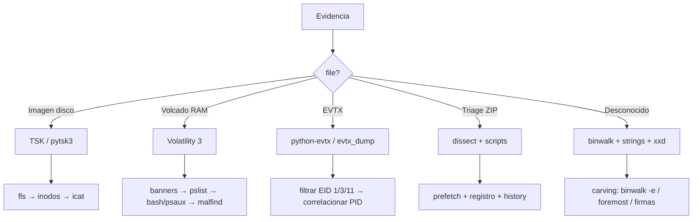

# 00 · Metodología General

> Esta página es el **cerebro** del kit: cómo decidir en los primeros 5 minutos qué camino seguir ante cualquier evidencia forense.

## Paso 0 · Higiene básica

```bash
# 1. Copia de trabajo (NUNCA toques el original)
cp evidence.img work.img
# o si es un dispositivo/imagen grande:
dd if=evidence.img of=work.img bs=4M status=progress conv=noerror,sync

# 2. Hash de verificación
md5sum evidence.img work.img
sha256sum evidence.img

# 3. Aísla tu entorno de trabajo
mkdir forense && cd forense
python3 -m venv .venv && source .venv/bin/activate
pip install pytsk3 dissect evtx python-registry
```

**¿Por qué venv?** Las librerías forenses de Python (`pytsk3`, `dissect`, `python-registry`, `python-evtx`) cambian rápido de versión. Un venv por reto evita conflictos y permite congelar las versiones que funcionaron.

## Paso 1 · Identifica el tipo de evidencia

```bash
file evidencia_*
```

| Salida de `file` | Tipo | Herramienta |
|---|---|---|
| `DOS/MBR boot sector` | Imagen de disco (HDD/USB) | TSK / pytsk3 |
| `GPT partition table` | Imagen de disco moderno | TSK / pytsk3 |
| `Linux rev 1.0 ext4 ...` | Filesystem sin particionar | TSK / debugfs |
| `data` pero enorme (>1GB) y suele llamarse `.raw`/`.mem`/`.lime` | Posible volcado RAM | `vol.py banners` para confirmar |
| `ELF core` | Core dump de proceso | Volatility 3 / gdb |
| `EVTX` (`Windows Event Log`) | Registro de eventos Windows | python-evtx / evtx_dump |
| `Zip archive` con `Windows.KapeFiles.Targets/` | Triage Velociraptor/KAPE | Parseadores dissect + scripts (03) |
| `PE32 executable` | Binario Windows | strings, binwalk, análisis PE |
| `PDF` / `Office` | Documento (¿phishing?) | pdfid/peepdf, olevba |

### Si `file` dice "data"

```bash
# Mirar la cabecera manualmente
xxd evidencia | head -5

# Firmas típicas de volcado de memoria:
#   "MAM\x04" → Prefetch Win10 (comprimido)         (no RAM)
#   "ELF"     → Core dump o volcado ELF
#   Bytes no homogéneos + datos tipo kernel   → raw memory dump
#   "LiME" magic "0x4C694D45"                 → Volcado LiME

# Comprobar si es un archivo comprimido disfrazado
binwalk evidencia | head -20

# Calcular entropía: alta y homogénea → cifrado/comprimido
python3 -c "
import math, collections
d = open('evidencia','rb').read(1<<20)
c = collections.Counter(d); n = len(d)
print('entropía =', -sum((v/n)*math.log2(v/n) for v in c.values()))"
```

## Paso 2 · Exploración barata (siempre primero)

```bash
# Strings ASCII y UTF-16
strings -n 8 evidencia | head -50
strings -el evidencia | head -50     # -el = little-endian 16-bit (UTF-16LE)

# Buscar patrones sospechosos
grep -aiob "flag{" evidencia 2>/dev/null
grep -aiob "http" evidencia | head
grep -aiobE "user|pass|pwd|login" evidencia | head
```

> **Truco:** `grep -aobc` sobre imágenes binarias: `-a` trata binario como texto, `-o` imprime el match, `-b` da el offset en bytes, `-c` cuenta. Si devuelve `0`, es la **prueba negativa** de que un IOC no está en claro (útil para demostrar que un payload está ofuscado).

## Paso 3 · Decide el camino



## Paso 4 · Ciclo de análisis (metodología iterativa)

1. **Recuento**: lista procesos / archivos / registros. No analices nada aún.
2. **Filtrado agresivo**: descarta ruido conocido (rutas `\Windows\`, paquetes legítimos, servicios del sistema).
3. **Foco**: elige 1–3 artefactos candidatos (un PID, un `.dat`, un dominio).
4. **Verificación cruzada**: confirma cada candidato con 2+ fuentes independientes (ej.: prefetch + historial PSReadLine + registro Amcache).
5. **Descarte activo de falsos positivos**: `strings`, `grep`, documentación pública del binario.
6. **Timeline**: ordena cronológicamente los eventos para entender la cadena de ataque.
7. **Respuesta**: extrae el IOC / PID / nombre pedido, y codifícalo en MD5 si el reto lo pide.

## La regla de oro para CTFs

> El enunciado **siempre** te dice qué tipo de evidencia es. Lee entre líneas: *"volcado de memoria"*, *"el USB del atacante"*, *"colección de artefactos"*, *"los logs del sistema"*. Aparece el patrón correcto y te ahorra 30 minutos de exploración a ciegas.

## Errores típicos de principiante

- Abrir Volatility 3 con una imagen de disco (y viceversa) → errores confusos de símbolos.
- Olvidar que `grep` sobre binario necesita `-a` → "no hay resultados" falsos.
- Creer que un fichero con extensión `.exe` es malicioso → validar siempre con `strings` / firma / hash público.
- No hacer copia de trabajo y desconfigurar la evidencia original.
- Quedarse en el primer hallazgo: el IOC real suele estar en el 4º-5º artefacto que revisas, no en el primero.
